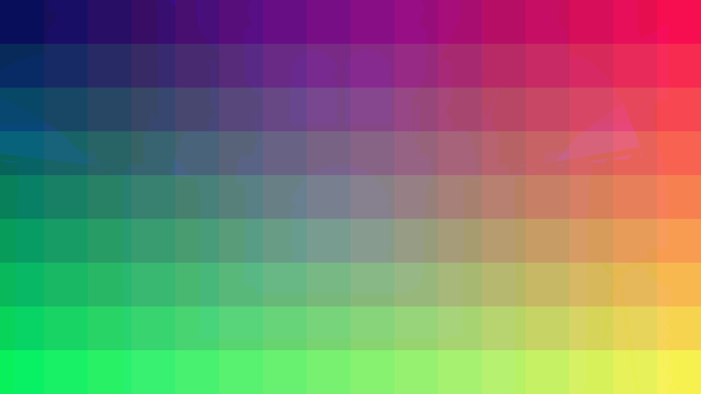
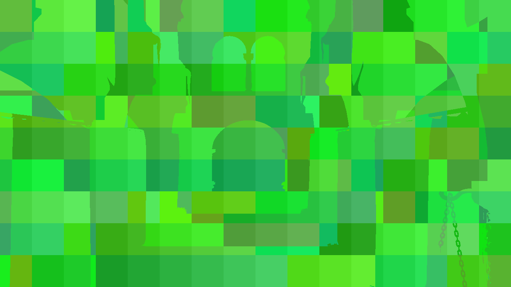
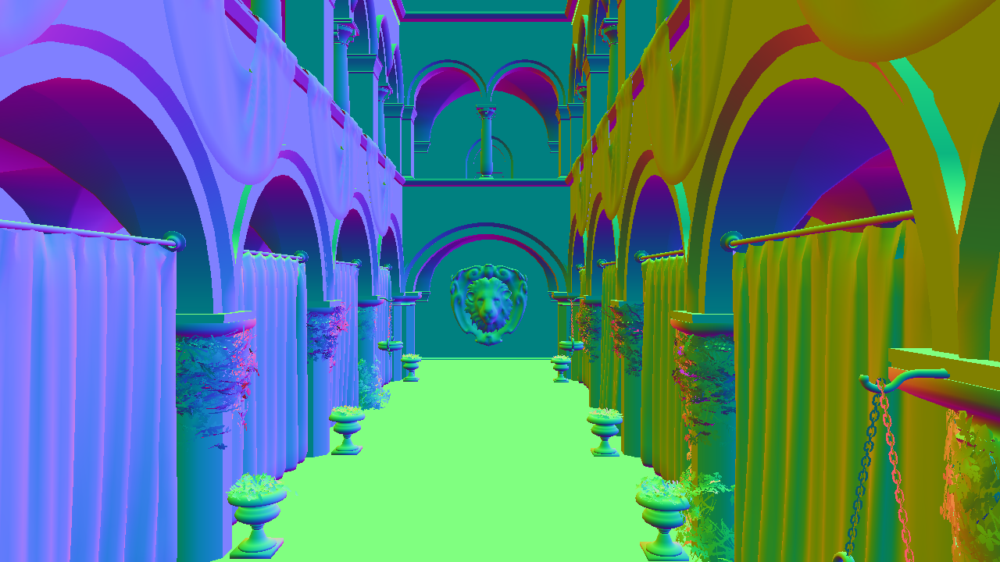
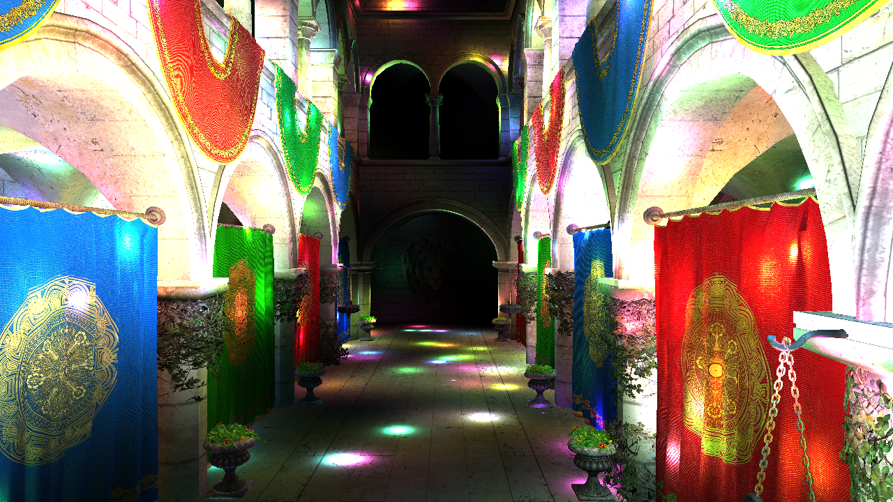
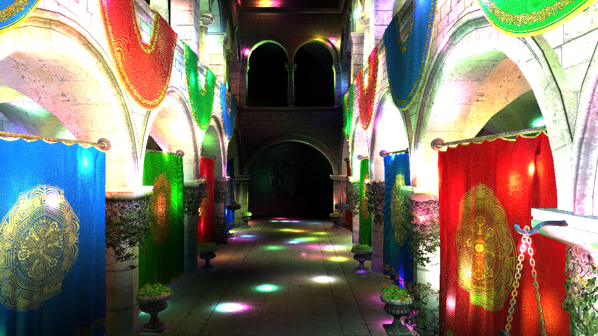
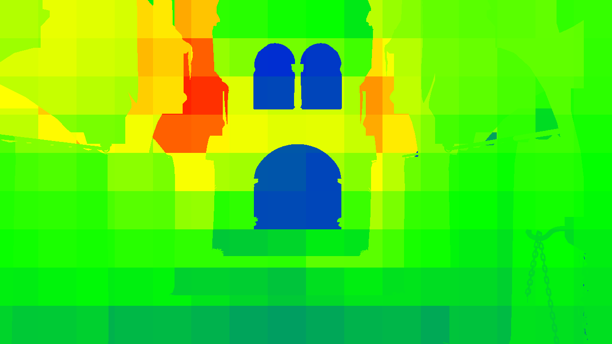
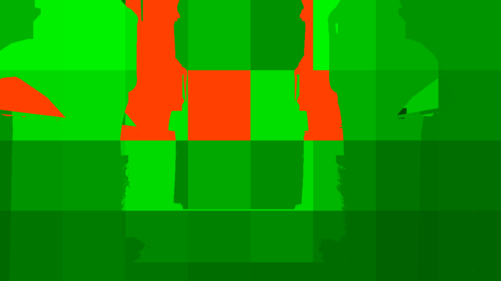
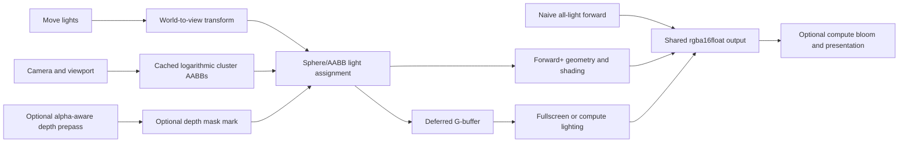

# WebGPU Forward+ and Clustered Deferred Shading

## University of Pennsylvania, CIS 5650: GPU Programming and Architecture, Project 4

- [Didrik Wiig-Andersen](https://github.com/didrikwiigandersen)
- Tested on: **Google Chrome** (captured user-agent: **154.0.0.0**; installed version: **155.0.8059.40**) on
  macOS 27.0.1, Apple M5 (10-core CPU, 10-core GPU), 24 GB unified memory (Mac17,2).

[](https://didrikwiigandersen.github.io/Project4-WebGPU-Forward-Plus-and-Clustered-Deferred/)

*Native 1280×720 capture: 5,000 frozen point lights, compact compute deferred lighting, render bundles, optimized
light math, and compute bloom in the Atrium view.*

An instrumented WebGPU renderer for studying how light count, screen resolution, cluster granularity, overdraw, and
G-buffer representation shift work between the CPU, geometry processing, light assignment, and per-pixel shading.
It keeps a naive forward path as a reference, shares one conservative clustering implementation between Forward+
and deferred rendering, and exposes optimizations independently so their costs can be measured rather than hidden
inside one preset.

## Demo

- **[Open the live build](https://didrikwiigandersen.github.io/Project4-WebGPU-Forward-Plus-and-Clustered-Deferred/)**
- **Captioned 50-second native feature tour:** [MP4](docs/media/feature-tour.mp4) ·
  [WebM alternative](docs/media/feature-tour.webm)

WebGPU requires a current compatible browser and a secure context (HTTPS or localhost). The video remains
available for systems without WebGPU.

## What is implemented

- **Naive forward reference:** shades each surviving alpha-tested fragment against every light.
- **Forward+:** assigns lights to a configurable 3D cluster grid, then shades from the per-cluster list. Direct draw
  and cached render-bundle paths are independently selectable.
- **Clustered deferred:** preserves the baseline MRT/fullscreen path while independently selecting fullscreen or
  compute lighting and baseline or compact G-buffer storage.
- **Compute Gaussian bloom:** half-resolution highlight extraction and separable radius-4, sigma-2 blur with
  clamped edges, distinct read/write textures, threshold `1`, and strength `0.2` by default.
- **Compute deferred lighting:** replaces the fullscreen lighting draw with 8×8-thread compute workgroups.
- **Compact G-buffer:** packs RGBA8 albedo and an octahedral SNORM16 normal into one `rgba16uint` attachment and
  reconstructs world position from depth.
- **Render bundles:** caches stable geometry command streams while continuing to read updated buffer contents.
- **Alpha-aware Forward+ depth prepass:** repeats material alpha cuts, writes with `less`, then uses `equal` with
  read-only depth to reject geometry behind the prepass surface. Exact coplanar ties can still pass, and a later
  draw can select a later material.
- **Depth-based active-cluster culling:** clears and marks a cluster mask from the prepass depth texture, then skips
  light-intersection work for inactive workgroups. It does not compact the dispatch.
- **Optimized point-light math variant:** rejects lights at `d² >= radius²` before square-root, attenuation, and
  light/normal work; uses `(1 - (d²/r²)²) / d²` attenuation; and normalizes the surface normal once before the
  light loop. The original helper remains selectable for paired timing and floating-point parity checks.

## Feature and debug views

| Cluster coordinates | Visible occupied clusters in Forward+ culling mode |
| --- | --- |
|  |  |
| Each visible fragment is colored by its logarithmic 3D cluster. | Surface fragments show visible occupied cluster IDs using the actual active-mask binding. Passive readback for this 1280×720 capture found 281/3,456 active clusters (8.13%); the image does not render empty cluster volume or the raw binary mask. |

| Decoded compact normals | Depth debug view |
| --- | --- |
|  |  |
| Compact compute deferred lighting decodes a two-component SNORM16 octahedral normal. | This compact compute-deferred capture shows raw WebGPU 0..1 hardware depth. |

| Bloom disabled | Compute bloom enabled |
| --- | --- |
|  |  |
| Compact compute deferred output with bloom disabled. | The same base configuration with threshold 1, strength 0.2, half-resolution extraction, and two compute blur passes. |

| Candidate-list length | Overflow fallback |
| --- | --- |
|  |  |
| The Forward+ heat map encodes the selected cluster's candidate-list length at visible surfaces; it is a structural diagnostic, not a timing result. | On the 8×4×16 grid, red identifies visible fragments whose selected cluster exceeded the runtime list capacity. The fallback evaluates the complete light set once. |

All nine stills are native 1280×720 captures with 5,000 lights, frozen time 1000, Atrium, bundles, and optimized
light math; the overflow capture alone uses the 8×4×16 grid. Exact configurations, byte sizes, and hashes are in
the read-only [`capture-manifest.json`](docs/media/capture-manifest.json).

The debug selector is renderer-aware. Forward+ implements clusters, light count, overflow, albedo, normals,
and logarithmic depth. Its active-clusters view is available only with depth-based culling and colors visible
occupied-cluster IDs at rendered surfaces. Deferred implements clusters, light count, overflow, albedo, normals,
and hardware depth; active-clusters is unavailable. The UI disables unsupported choices and resets a current view
to `none` when it becomes unsupported. Bloom inspection is a shared post-process view. Naive has no
cluster/material debug path.

## Pipeline



The default grid is `16×9×24` (3,456 clusters); `8×4×16` and `32×18×24` are also available. Depth slices are
logarithmic between near `0.1` and far `1000`. Each cluster record stores a count, an overflow flag, and a
runtime-capacity-sized array of `u32` indices. Conservative bounds favor correctness over perfectly tight lists;
overflow falls back to the complete light loop rather than dropping illumination.

### G-buffer storage

| Path | Logical attachments | Logical bytes/pixel |
| --- | --- | ---: |
| Baseline | `rgba32float` position + `rgba16float` normal + `rgba8unorm` albedo + `depth32float` | 32 |
| Compact | `rgba16uint` packed albedo/normal + `depth32float` | 12 |

The compact layout reduces logical G-buffer storage by **62.5%**. These figures describe texel formats, not driver
allocation or measured bandwidth, and exclude the common `rgba16float` lighting output and presentation target.
World position is reconstructed with inverse view-projection using WebGPU’s 0..1 hardware depth and screen-Y
convention.

For resource layouts, pass ordering, cache invalidation, and failure behavior, see
[`docs/architecture.md`](docs/architecture.md).

## Controls

| Input | Action |
| --- | --- |
| Hold primary mouse button + drag | Look around; release or press Escape to unlock |
| `W` / `A` / `S` / `D` | Move forward / left / back / right |
| `Q` / `E` | Move down / up |
| `Shift` | Move 3× faster |
| `Alt` | Move 3× slower |

The GUI selects renderer, 0–5,000 point lights, Atrium/Arcade/Overview camera, fit/720p/1080p resolution, frozen
lights, cluster grid, bundles, Forward+ depth mode, deferred compute, compact storage, bloom threshold/strength, and
debug view. Native evidence controls run validation, full/quick/capacity benchmarks, screenshots, and recording.
Development and production-preview pages served from `localhost` or `127.0.0.1` save under `docs/` through the
local evidence endpoint. A normal public build downloads completed final reports instead; checkpoints and recovery
parts suppress that download fallback.

## Performance

The [full performance analysis](docs/performance/analysis.md) defines exact pairings, raw-sample validation, timing
boundaries, complete before/after tables, and limitations. All named final reports pass the offline validator:
the lossless-gzip [`full report`](docs/performance/benchmark-full.json.gz) contains 176 cases, 528 repeat rows, and
158,400 raw samples with zero rejected frames; a tabular [CSV export](docs/performance/benchmark-full.csv) is also
available. [`capacity-256.json`](docs/performance/capacity-256.json) contains six cases, 18 rows, and 5,400 samples;
[`capacity-1024.json`](docs/performance/capacity-1024.json) contains 12 cases, 36 rows, and 10,800 samples. Figures
are generated only from those final native reports:

- [Renderer scaling by light count, camera, and resolution](docs/performance/figures/renderer-light-count.png)
- [Cluster-grid scaling](docs/performance/figures/cluster-grid-scaling.png)
- [Isolated and combined feature deltas](docs/performance/figures/feature-deltas.png)
- [Optimized point-light math isolation](docs/performance/figures/optimized-light-math.png)
- [Render-bundle CPU encoding and submission](docs/performance/figures/render-bundles-cpu.png)
- [Cluster-list capacity comparison](docs/performance/figures/capacity-comparison.png)
- [Capacity-study light-math isolation](docs/performance/figures/capacity-kernel-comparison.png)

Measured takeaways on this Apple M5 capture:

- Forward+ had the lowest base-renderer median in all four 128-light camera/resolution cases. Clustered deferred
  led all 16 cases from 512 through 5,000 lights. At 5,000 lights, deferred medians were 7.209–24.05 ms, Forward+
  medians were 26.41–70.45 ms, and naive medians were 270.7–579.1 ms.
- The `32×18×24` grid was lowest in all ten 1080p Atrium grid comparisons. Relative to `8×4×16`, its median was
  7.0–57.1% lower across the two clustered renderers and five light counts; this does not imply that still-finer
  grids would continue to improve.
- The Forward+ prepass reduced all four 5,000-light medians by 17.367–37.224 ms but increased all four 128-light
  medians by 0.131–0.590 ms. Active-cluster culling, measured strictly against prepass, produced no lower pooled
  median. Compute lighting, compact storage, and bloom were mixed or commonly one timestamp step apart; their
  repeat ranges often crossed zero. Combined rows are composite observations, not attribution to one sub-feature.
- Optimized point-light math lowered 15/16 full-report medians and all eight 5,000-light pairs by 0.655–13.238 ms;
  the remaining pair was unchanged. Render bundles did not resolve a CPU-median benefit—the browser reported zero
  for both sides in all 24 pairs—and GPU medians were lower/equal/higher in 5/9/10 pairs, so bundles were not a
  blanket timing win in this scene.
- In the capacity study, capacity 1024 reduced all six reference-kernel medians by 127.664–355.598 ms while growing
  logical cluster storage about 3.98×. It removed visible overflow for both finer grids and reduced the coarse-grid
  visible-overflow fraction from 100.00% to 11.07%. The separately isolated 1024-capacity light-math flag lowered
  all six medians by 1.769–36.504 ms.

These are local workload results, not a general renderer ranking or a guarantee on other hardware.

The protocol uses 120 warmup frames, 300 valid samples, three repeats, alternating case order, frozen light time
`1000`, and xorshift seed `0x6d2b79f5`. GPU render time is not replaced with CPU time when `timestamp-query` is
unavailable. The native M5 study observed an empirical 65.536-microsecond (65,536 ns, or 0.065536 ms) GPU
granularity. For the legacy capacity-256 capture, the build manifest records a GCD over observed timestamp
durations; new reports record `timestampQuantumNs` from differences between timestamp endpoints. These are distinct
empirical resolution bounds, not claims about a physical clock period. Sub-bound pass values do not establish zero
cost, and CPU timing has separate precision.

The full report contains 176 configurations: 160 inherited cases with optimized light math enabled and 16
otherwise matched reference-kernel cases. The legacy capacity-256 report has six reference cases; capacity 1024
adds the six matching optimized-kernel cases. Every other feature comparison keeps the kernel choice fixed.

Host inventory is recorded in [`hardware.json`](docs/performance/hardware.json): Apple M5 / Mac17,2, 10-core CPU
(4 performance + 6 efficiency), 10-core GPU, 24 GB unified memory, macOS 27.0.1, and installed Chrome
155.0.8059.40. That installed version is not the capture identifier: all three raw reports independently record a
`Chrome/154.0.0.0` user-agent and matching Apple `metal-3` adapter information. The reduced user-agent's
`Mac OS X 10_15_7` token is browser-reported text, not physical-OS inventory. Public-native
[`validation.json`](docs/performance/validation.json) is tied to source
`39287f3fc59d33444d18046cc0eda2d5de051a00`; it was captured at `2026-10-13T05:28:49.046Z` from the public GitHub
Pages HTTPS build in native Chrome on the Apple GPU and records 35/35 native GPU checks passing with zero GPU
errors. That source also passed 23 CPU tests, typecheck, and a production build. The preserved
[A54 validation](docs/performance/validation-capacity-1024.json) is the parity evidence associated with the measured
renderer source, while the preserved [`initial validation report`](docs/performance/validation-initial-1024.json)
documents the corrected bloom fixture.

Capture-specific provenance is in [`build-manifest.json`](docs/performance/build-manifest.json): capacity 256 used
`ecbaecd005b4bb4a666cbc3bfe98099a5190dd27`; capacity 1024 and the full benchmark used measured source
`a54d4089a82844d70fa322721b8403f026188b0c`. The benchmark was not rerun at either later source. Public-native GPU
validation and the shader-processing fix belong to `39287f3fc59d33444d18046cc0eda2d5de051a00`. Final packaged
source is `a256db158cd8bf04a264d1ac2cedd8fa4be803eb`; its manifest snapshot records 55 hashes and eight changed paths
since A54. Its sole change after the validated 39287 source is `style.css`: `object-fit: contain` on `#mainCanvas`
preserves the fixed 720p or 1080p drawing-buffer aspect ratio inside differently shaped CSS viewports. JavaScript
and generated-shader bytes, canvas client and drawing-buffer dimensions, renderer math/layout, and timed paths are
unchanged by that property.
The recorded raw `.wgsl` inputs and renderer implementations still match A54. The
[`shader-build parity proof`](docs/performance/shader-build-parity.json) reports all 18 exported processed shaders
byte-identical across measured development, fixed development, and application-like minified production processing;
its emitted-bundle audit found all 21 unique shader-module strings exact, with zero mismatches, byte delta,
unresolved placeholders, or `undefined` tokens. The proof links its pre-edit F241 development capture to A54 through
an identical shader tree and matching Vite/package/TypeScript build inputs. This proof is committed evidence for
39287; it is not relabeled as an A256 validation.

Historical source `d39577f365cf0aa547d9ad60f0dd5aafb8ab2c89` and validated source 39287 both remain in
`releaseHistory`. D395's
[`UI-restoration validation`](docs/performance/validation-ui-restoration.json) records 35/35 native checks and the
camera-preset cleanup. Its initial public deployment at `f241a2f7c56c7f2126a9112ec59f071ce24ead6b` is preserved
in the [`failed production report`](docs/performance/validation-production-initial.json): 28/35 checks failed with
377 GPU errors because production tree shaking removed `lightRadius`, whose only host reference was hidden inside
eval-based WGSL interpolation. The corrected loader uses validated explicit property substitution. This changes
one-time host processing, not WGSL math, renderer paths, resource layouts, workloads, or validation thresholds.

Chart regeneration requires Python 3 and Matplotlib. Regenerate validated PNG and SVG figures offline with:

```bash
python3 scripts/plot_performance.py
```

The script uses Matplotlib as offline tooling; it is not a browser/runtime dependency. It accepts final `.json` or
`.json.gz` reports, ignores checkpoints and recovery parts, requires raw evidence, recomputes pooled medians and
p95 values from 900 samples per case, and reports the range of the three repeat medians rather than inventing
confidence intervals.

## Build and verify

```bash
npm install
npm run dev
```

Then open the local HTTPS/localhost URL in a WebGPU-capable browser. Useful verification commands are:

```bash
npx tsc --noEmit
npm test
npm run build
```

## Credits

- Official CIS 5650 Project 4 starter, baseline SHA `a3d826d53a22668a7ae7da23463911303f24a1f5`, and its Sponza scene/assets.
- [Vite](https://vitejs.dev/), [loaders.gl](https://loaders.gl/),
  [dat.GUI](https://github.com/dataarts/dat.gui), [stats.js](https://github.com/mrdoob/stats.js), and
  [wgpu-matrix](https://github.com/greggman/wgpu-matrix).
- The starter’s light-motion noise retains its source attribution to Stefan Gustavson and
  [Munrocket’s MIT-licensed WGSL port](https://gist.github.com/munrocket/236ed5ba7e409b8bdf1ff6eca5dcdc39).
