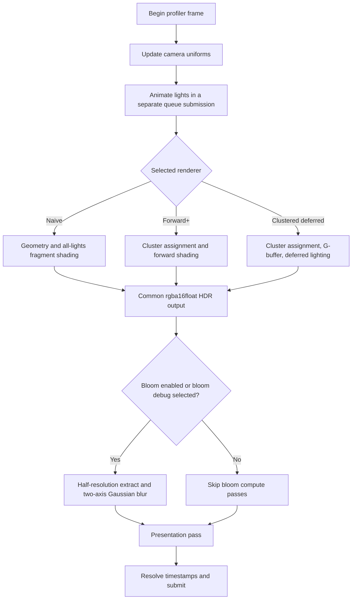
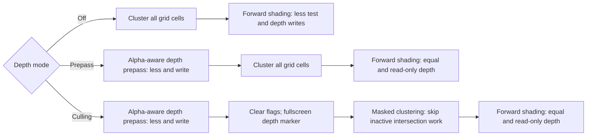

# Rendering architecture

This document describes the implementation in this repository: the shared WebGPU runtime, naive reference renderer, Forward+ renderer, clustered deferred renderer, post-processing path, and the measurement and diagnostic boundaries around them. It is an implementation reference rather than a performance claim; measured results live in [`performance/analysis.md`](performance/analysis.md).

## Runtime structure

`main.ts` initializes WebGPU, loads Sponza, constructs a shared `Stage`, and selects one concrete `Renderer`. The stage owns the scene, camera, lights, and UI statistics object. Renderer changes create a new renderer around that shared stage; renderer-specific textures, pipelines, bind groups, and bundles are disposed and rebuilt, while the scene geometry, camera buffer, and light buffers remain shared.

The main control surface is the `ProjectApp` interface in [`src/app_api.ts`](../src/app_api.ts):

| Interface member | Contract |
| --- | --- |
| `renderer`, `camera`, `lights`, `errors` | Expose the current renderer and shared stage state to validation, benchmarking, and capture code. |
| `configure(configuration)` | Applies a partial configuration, clamps and uploads the light count, applies an optional camera preset and fixed drawing-buffer size, then recreates the renderer so constructor-selected pipeline variants agree with the settings. |
| `pause()` / `resume()` | Stop automatic animation or recreate and restart the selected renderer. Evidence collection pauses before asynchronous readback. |
| `render(time)` | Renders one deterministic manual frame; benchmark cases normally freeze lights at the configured fixed time. |
| `setStatus(message)` | Reports progress without entering the rendering path. |

The abstract `Renderer` owns a common full-resolution `rgba16float` HDR output and a `PostProcessing` instance. Subclasses implement `draw()` and optional resize/disposal hooks. The common per-frame sequence is:

Light movement is deliberately submitted before the renderer command buffer. Queue ordering supplies the dependency without a CPU wait, and the separate timestamp lets render-only measurements exclude movement.

## Shared GPU interface

### Geometry, model, and material data

All geometry pipelines use the same 32-byte interleaved vertex record:

| Shader location | Value | Format | Byte offset |
| --- | --- | --- | ---: |
| 0 | object-space position | `float32x3` | 0 |
| 1 | object-space normal | `float32x3` | 12 |
| 2 | texture coordinate | `float32x2` | 24 |

The stable draw-time bind-group convention is:

| Group | Binding | Resource |
| ---: | ---: | --- |
| 0 | renderer-dependent | Scene resources, described below. |
| 1 | 0 | One 64-byte model matrix uniform for the current node. |
| 2 | 0, 1 | Base-color texture and sampler for the current material. |

`drawGeometry` changes group 1 per node and group 2 when the sorted material changes, then binds the primitive vertex/index buffers and issues `drawIndexed`. A render bundle records those same pipeline, binding, buffer, and draw commands; render-pass attachments are intentionally outside the bundle.

### Camera ABI

The CPU `CameraUniforms` mirror and WGSL `CameraUniforms` struct are 304 bytes. Every field starts on a 16-byte boundary.

| Offset | Field | Purpose |
| ---: | --- | --- |
| 0 | `viewProjMat` | Geometry projection. |
| 64 | `viewMat` | World-to-view light transformation. |
| 128 | `invProjMat` | View-position reconstruction and cluster-bound construction. |
| 192 | `invViewProjMat` | World-position reconstruction from depth. |
| 256 | `viewport` | Width, height, reciprocal width, reciprocal height. |
| 272 | `depth` | Near plane, far plane, logarithmic scale, logarithmic bias. |
| 288 | `clusterDims` | X/Y/Z cluster counts and the shader-visible list capacity. |

The near and far planes are 0.1 and 1000. The projection follows WebGPU's hardware-depth interval of 0–1. Reconstruction converts top-left-origin pixel Y to NDC Y explicitly.

### Lights and clusters

The world-light storage buffer begins with a 16-byte `LightSet` header containing the active count. Each light then occupies a 32-byte WGSL-aligned record: a padded `vec3f` position followed by a padded `vec3f` color. Storage is allocated for the supported maximum light population; only the active prefix is moved, transformed, clustered, or shaded.

Cluster resources depend on grid dimensions `(Nx, Ny, Nz)`, with `N = Nx * Ny * Nz`. The default `16x9x24` grid therefore has 3,456 clusters. Resource sizes are:

| Resource | Logical record | Logical/requested size |
| --- | --- | ---: |
| View-space light positions | one `vec4f` per light | `16 * maxLights` bytes |
| Cluster bounds | `min: vec4f`, `max: vec4f` | `32 * N` bytes |
| Cluster light lists | `count`, `overflow`, then `capacity` `u32` indices | `4 * (2 + capacity) * N` bytes |
| All-active or depth-derived mask | one `u32` flag per cluster | `4 * N` bytes |

`capacity` is an implementation parameter exported by `Lights` and captured in diagnostics and benchmark reports. Memory comparisons must substitute the capacity reported with the data being analyzed; they must not assume a permanent value. The host record stride, shader array length, camera metadata, validation offsets, and report metadata must all describe the same capacity.

These formulas describe format-level logical storage and the requested WebGPU buffer sizes. They do not measure driver allocation, heap granularity, cache traffic, compression, padding, or effective bandwidth.

### Bind-group layouts

The principal layouts are summarized below. Visibility differs slightly by pipeline, but binding numbers and meanings remain stable where the interfaces are shared.

| Consumer | Group and bindings |
| --- | --- |
| Naive scene | Group 0: camera uniform (0), world lights read-only storage (1), cluster set read-only storage (2). Binding 2 is retained for scene-ABI compatibility although naive shading does not read it. |
| Forward+ scene | Group 0: camera (0), world lights (1), cluster set (2), 16-byte debug uniform (3), renderer-owned `activeMaskBuffer` as read-only storage (4). Binding 4 always uses that renderer buffer in every depth mode. |
| Forward+ prepass | Group 0: camera only (0); groups 1 and 2 retain model and alpha-tested material data. |
| Forward+ marker | Group 0: camera (0), sampled depth (1), read/write atomic active flags (2). |
| Deferred scene | Group 0: camera (0), world lights (1), cluster set (2), visible to the selected fragment/compute lighting stages. |
| Deferred lighting resources | Group 3: baseline position/normal/albedo textures at 0/1/2, or compact integer texture at 0; depth at 3; 16-byte debug/dimensions uniform at 4; compute output storage texture at 5 when compute lighting is selected. Groups 1 and 2 are empty placeholders in the lighting-only pipeline layout. |
| Light movement | Group 0: read/write world lights (0), time uniform (1). |
| View-space transform | Group 0: world lights (0), camera (1), read/write view positions (2). |
| Cluster bounds | Group 0: camera (0), read/write bounds (1). |
| Light assignment | Group 0: world lights (0), camera (1), view positions (2), bounds (3), active mask (4), read/write cluster set (5). |
| Bloom compute | Group 0: sampled input (0), write-only `rgba16float` output (1), parameters/direction uniform (2). |
| Presentation | Group 0: HDR lighting (0), bloom texture (1), filtering sampler (2), bloom/presentation parameters (3). |

## Cluster construction and light assignment

Both clustered renderers use the same view-space cluster data.

1. **Logarithmic depth partition.** For positive view depth `d`, the Z slice is the clamped value `floor(log(d) * scale + bias)`, where `scale = Nz / log(far / near)` and `bias = -log(near) * scale`. Pixel X and Y select uniform screen tiles. Linear cluster indexing is `x + y * Nx + z * Nx * Ny`.
2. **Conservative bounds.** A 64-thread compute kernel visits each cluster. It computes the logarithmic near/far distances for the slice, unprojects all eight tile/slice corners with the inverse projection, and encloses them in a view-space AABB. The bounds expand by a depth-scaled epsilon rather than shrinking at floating-point boundaries. The AABB can admit false-positive lights near a cluster frustum, increasing list and shading work, but preserves the conservative coverage required for correctness.
3. **One transform per light.** A 128-thread compute kernel transforms each active light center from world to view space once per clustered frame. Geometry shading continues to use the original world-space light records.
4. **One workgroup per cluster.** A 64-thread workgroup tests lights in a strided loop. A sphere of radius 2 intersects an AABB when the squared distance from its center to the closest point on the AABB does not exceed the squared radius. Workgroup atomics allocate list entries, and lane zero writes the final count and overflow flag after a barrier.
5. **Optional activity mask.** When `Lights.doLightClustering` receives no external mask, its clustering-only bind
   group uses an internal pre-filled all-active fallback. Forward+ culling instead supplies the renderer-owned,
   depth-derived `activeMaskBuffer`. This compute-binding choice is separate from Forward+ scene binding 4, which
   always references the renderer-owned buffer. Inactive workgroups still run far enough to clear stale
   count/overflow fields and reach both barriers, but skip all sphere/AABB tests. The dispatch remains `N`
   workgroups; there is no compaction or indirect reduced dispatch.

The bounds describe projection-defined frustum cells in view space. They are cached and regenerated only when the grid/resource identity, projection, or viewport changes, or when explicitly invalidated. Camera translation and rotation do not change those shapes. View-space light positions, by contrast, are refreshed every clustered frame.

### Point-light math variant

`optimizedLightMath` is an independently reported configuration axis for the retained reference and optimized
point-light calculations. Missing fields in the original capacity-256 evidence canonicalize to `false`; the 160
inherited full-benchmark configurations use `true`, with 16 extra reference cases added only for exact kernel
pairing. The optimized path rejects a light when `d² >= radius²` before square-root, attenuation, and light/normal
work; evaluates attenuation as `(1 - (d²/r²)²) / d²`; and hoists surface-normal normalization outside the light
loop. The `false` path retains the original helper body. Native parity tests assess changes caused by `f32`
rounding. This is an optimization measurement axis rather than a new architectural feature, and paired timing
cannot establish which individual transformation caused a measured delta.

### Overflow behavior

The cluster record stores at most `capacity` indices. If the actual intersection count exceeds that limit, clustering stores a clamped count and sets `overflow`. Shading tests the flag before iterating the list and takes exactly one complete all-lights path for that pixel. It does not shade the partial list and then add all lights, so contributions are neither omitted nor doubled. This preserves lighting correctness at a potentially large and spatially concentrated cost. Diagnostics therefore report both overflowing clusters and visible pixels whose selected cluster overflowed.

## Renderer pass flows

### Naive reference

Naive rendering encodes one geometry pass with `less` depth testing and depth writes. Each alpha-surviving fragment loops over every active light and writes the result to the common HDR target. It does not execute cluster-bounds, transform, or assignment passes. Its group-0 cluster binding exists only to keep the geometry scene contract compatible with the other renderers.

The naive depth attachment uses `depth24plus`. Because that format is implementation-defined and the texture is not created for copy readback, the diagnostics path does not claim a per-pixel depth storage size or read it back.

### Forward+

Forward+ chooses among three depth flows:

The prepass samples the same material texture and applies the same alpha cutoff as final shading. This keeps depth
coverage correct for Sponza cutouts. Reusing an invariant vertex position with `equal` depth comparison rejects
geometry behind the prepass surface and disables final-pass depth writes. It does not guarantee exactly one final
fragment invocation per pixel: exactly coplanar primitives/fragments can both pass `equal`, and a later draw can
select a later material. Validation therefore uses a separate coplanar-tie policy for prepass versus the naive
reference, while the prepass-versus-culling comparison remains strict.

In culling mode, a six-vertex fullscreen quad samples `depth32float` without binding a depth attachment. Pixels with depth below the clear value compute their cluster index and atomically store 1 into that cluster's flag. A full-resolution `r8unorm` color attachment is used as a required scratch render target; it is not the activity data structure. The atomic `u32` buffer is cleared before marking and is the mask consumed by clustering.

All Forward+ variants shade directly from material textures and the selected cluster list into `rgba16float`. The direct path can encode ordinary draws or execute a compatible cached render bundle.

### Clustered deferred

Deferred rendering always performs shared light clustering, then a geometry G-buffer pass, then one lighting pass. Storage and lighting mechanism are independent constructor-selected axes, giving four combinations:

- baseline MRT plus fullscreen fragment lighting;
- baseline MRT plus compute lighting;
- compact G-buffer plus fullscreen fragment lighting;
- compact G-buffer plus compute lighting.

Fullscreen lighting draws a six-vertex quad. Compute lighting dispatches 8x8-thread workgroups and bounds-checks edge invocations, so odd resolutions remain valid. Background pixels at depth 1 write black. Both paths call the same cluster selection, debug, and lighting helpers and write the common HDR format.

The baseline and compact G-buffers have the following format-level logical footprints:

| G-buffer | Color attachments | Depth | Logical total |
| --- | --- | ---: | ---: |
| Baseline | world position `rgba32float` (16 B), world normal `rgba16float` (8 B), albedo `rgba8unorm` (4 B) | `depth32float` (4 B) | 32 B/pixel |
| Compact | packed albedo and normal `rgba16uint` (8 B) | `depth32float` (4 B) | 12 B/pixel |

The compact path is therefore a 62.5% reduction in logical G-buffer bytes per pixel. It packs RGBA8 albedo into the low/high 16-bit halves of two lanes and an octahedral SNORM16x2 normal into the other two lanes. World position is omitted and reconstructed from depth with `invViewProjMat`. Alpha testing remains in both G-buffer geometry variants.

The table deliberately excludes the common `rgba16float` HDR output, swap-chain presentation, and any post-processing textures because those resources are identical across the G-buffer comparison. It also does not imply a 62.5% reduction in physical allocation or bandwidth: row padding, attachment tiling, compression, cache behavior, load/store traffic, and driver allocation remain implementation-dependent.

## Bloom and presentation

Bloom is common to every renderer. When bloom is enabled—or when the bloom debug view is selected—the post-processing system:

1. downsamples the HDR source into a distinct half-resolution `rgba16float` bright-pass texture by averaging each clamped 2x2 source footprint and applying the brightness threshold;
2. applies a separable radius-4, sigma-2 Gaussian horizontally into a second texture;
3. applies the same kernel vertically into a third texture, clamping sample coordinates at every edge; and
4. linearly upsamples and adds the blurred image during presentation using the configured strength.

Distinct input/output textures avoid read/write feedback within a dispatch. Extraction and both blur passes use 8x8 compute workgroups. The presentation pass draws one fullscreen triangle and clamps the final value to the display interval. Bloom debug still runs the bloom passes but presents the blurred texture alone. With bloom disabled, the compute passes are omitted and strength is written as zero.

## Resource lifetime, caching, and invalidation

| Cached object | Reuse rule | Invalidation/rebuild trigger |
| --- | --- | --- |
| Cluster bounds | Reused across frames because the AABBs depend on projection, grid, and viewport—not camera view. | New grid resources, projection change, viewport change, or explicit invalidation. |
| Cluster buffers/bounds/all-active mask | Sized to the complete grid shape. | Any X/Y/Z dimension change, including a new shape with the same total cluster count. Old buffers are destroyed after replacement; WebGPU defers physical release while submitted commands still reference them. |
| External clustering-mask bind group | Reuses the last external buffer identity. | A different mask buffer or grid-resource recreation. |
| Naive scene group and geometry bundle | Reuses stable camera/light/cluster buffer identities. | Cluster-buffer identity change; the otherwise-unused compatibility binding changes too. |
| Forward+ shading groups/bundles | Separate bundles exist for ordinary `less` shading and equal-depth/read-only shading. Buffer contents may change without invalidation. | Cluster-buffer identity change rebuilds the scene group and invalidates both shading bundles. |
| Forward+ prepass bundle | Contains stable camera, model, material, and geometry resource identities. | Renderer recreation; it has no cluster-buffer dependency. |
| Forward+ depth/marker textures and marker group | Sized to the drawing buffer. | Resize recreates depth and `r8unorm` scratch textures and rebinds the sampled depth view. Grid-shape changes recreate the atomic flag buffer and marker group. |
| Deferred geometry bundle | Records the constructor-selected G-buffer pipeline and current scene group. | Scene-group resource identity change or renderer recreation. Resizing attachments alone does not change bundle compatibility. |
| Deferred G-buffer and lighting group | Sized to the drawing buffer and selected storage variant. | Resize, compact/baseline change, compute/fullscreen change, or renderer recreation. |
| Bloom textures/groups | Three textures are sized to `ceil(width/2)` by `ceil(height/2)`. | Resize recreates them; a new HDR source identity rebuilds extraction and presentation bindings. Threshold/strength updates only rewrite uniforms. |

Render bundles reference buffers, bind groups, vertex/index buffers, and pipelines; they do not snapshot mutable buffer contents. Per-frame camera, debug, and light data can therefore be uploaded without rebuilding a compatible bundle.

## Debug-view support

The UI exposes one shared selector, but support is renderer-specific:

| View | Naive | Forward+ | Clustered deferred |
| --- | --- | --- | --- |
| `none` | Normal shading | Normal shading | Normal shading |
| `clusters` | Not locally implemented | Cluster-coordinate color | Cluster hash color |
| `light-count` | Not locally implemented | Cluster-list heat map | Cluster-list heat map |
| `overflow` | Not locally implemented | Count-aware green/red overflow display | Green/red overflow display |
| `albedo` | Not locally implemented | Sampled material albedo | Decoded/stored G-buffer albedo |
| `normals` | Not locally implemented | Interpolated world normal | Decoded/stored G-buffer normal |
| `depth` | Not locally implemented | Logarithmic cluster-depth visualization | Raw WebGPU hardware depth |
| `active-clusters` | Unavailable; disabled by UI | Available only in culling mode: visible surface fragments are colored by occupied cluster ID using the actual active-mask binding; this does not render empty volume or the raw binary mask | Unavailable; disabled by UI |
| `bloom` | Common post-processing support | Common post-processing support | Common post-processing support |

The UI disables unsupported choices and resets the current debug view to `none` if a renderer change makes it
unsupported. Bloom debug is global and forces the bloom passes even when the bloom feature toggle is off.

## Profiling and diagnostics boundaries

### Timestamp profiler

GPU timestamps are optional. If the adapter exposes `timestamp-query`, the device requests it and the profiler maintains six asynchronous slots, each with a 64-entry query set, resolve buffer, and map-readable buffer. A pass consumes two entries. Normal rendering does not synchronously wait for query readback; a frame without a free slot is simply not GPU-sampled. Benchmarks call `waitForCapacity()` and `drain()` so their required samples are complete.

Pass labels cover light movement; conditional cluster-bounds generation; view-light transformation; clustering; renderer geometry/prepass/marker/lighting; bloom extraction and both blur axes; and presentation. The reported quantities have distinct boundaries:

- `passes[label]` is the timestamp difference within that labeled GPU interval. Intervals may overlap on the
  native pipeline, so they are diagnostic spans rather than exclusive stage costs and must never be added.
- `renderMs` spans from the first timestamped pass after `Light movement` through presentation. It is an elapsed render span, not the sum of selected pass medians.
- `gpuMs` spans from the first timestamp in the frame—including light movement when it ran—through presentation, including queue-order gaps between those timestamps.
- `cpuMs` covers renderer draw encoding and submission. Its timer starts after camera update and the light-movement setup/submission; asynchronous mapping completion and sample processing happen outside the interval.

The native M5 evidence contains two deliberately distinct calibration records. The capacity-256 build manifest
records a 65.536-microsecond (65,536 ns, or 0.065536 ms) GCD over observed timestamp durations; its report retains
older descriptive `timestampPrecision` text. New reports store `timestampQuantumNs`, computed from differences
between timestamp endpoints. Both are empirical resolution bounds for their captures, not claimed physical GPU
clock periods, and the duration observation is not silently substituted for a missing endpoint-difference field.
A pass median at or below the applicable bound does not prove zero cost, and neither bound applies to the separate
CPU timer. Browser and adapter identity must match; numeric endpoint-difference calibrations must agree whenever
both compared reports provide them.

Each raw report records its own `userAgent` and `adapterInfo`, which are the identifiers used for cross-report
matching. `hardware.json` is separate host inventory—including the installed Chrome version—and is not substituted
for the captured user-agent. The reduced operating-system token inside a user-agent is likewise not treated as the
physical operating-system inventory.

The final performance reports and their preserved
[`validation-capacity-1024.json`](performance/validation-capacity-1024.json) parity evidence are tied to measured
source `a54d4089a82844d70fa322721b8403f026188b0c`. Release UI source is
`d39577f365cf0aa547d9ad60f0dd5aafb8ab2c89`; the benchmark was not rerun at that commit. The build manifest records
54 hashes for each snapshot and five changed controller/automation paths: `src/app_api.ts`, `src/benchmark.ts`,
`src/capture.ts`, `src/main.ts`, and `src/validation.ts`. Every shader/renderer hash is unchanged, and no benchmark
case, timed-frame collection, or camera-matrix behavior changed. Final release
[`validation.json`](performance/validation.json) covers the later source. Release accessibility verification selected
Arcade, ran Atrium validation fixtures, then confirmed cleanup restored the Arcade dropdown and 720p resolution
before restoring the exact saved pose.

When timestamp queries are unavailable, GPU and render times remain `null`/unavailable; CPU time is emitted separately and is never substituted for GPU time. Invalid timestamp order or mapping failures increment the rejected-sample count.

### Passive diagnostics

`collectDiagnostics` is an explicit, asynchronous readback operation, not a timed-frame pass. The caller must first pause rendering and provide an already-rendered stable frame. Benchmarking invokes it after each measured sample block, so copy submission, mapping, and CPU scanning do not contaminate timed frames.

The collector snapshots CPU-side settings and resource identities before launching readbacks. It then reads, where supported:

- cluster records for Forward+ and deferred modes;
- the Forward+ active-mask buffer only when culling is enabled; and
- `depth32float` textures created with `COPY_SRC` usage.

It reports grid and capacity metadata, logical cluster storage, active fraction, list count statistics, overflowing-cluster fraction, valid visible-depth coverage, and the fraction of visible pixels mapped to overflowing clusters. Naive mode does not claim clustering use, and its `depth24plus` attachment is intentionally not treated as readback-compatible.

## Correctness and failure behavior

- WebGPU initialization fails visibly when WebGPU, a suitable adapter/context, device creation, or the required WGSL `unrestricted_pointer_parameters` language feature is unavailable. Timestamp queries remain optional.
- Uncaptured GPU errors are recorded and dispatched to the page. Device loss records its reason, surfaces an event, and prevents additional animation frames from being scheduled.
- Drawing-buffer dimensions are clamped to at least one pixel and to the device's maximum 2D texture dimension. Resizing recreates all size-dependent attachments before subsequent drawing.
- Cluster-grid parsing rejects non-positive or non-integer dimensions, cluster-count construction rejects unsafe counts, and an externally supplied active mask must be at least `4 * N` bytes.
- Shader loops clamp advertised light and cluster counts against runtime array lengths. Invalid cluster indices are clamped before record access.
- Every clustering workgroup clears its count and overflow fields before optional mask rejection. Zero-light and newly inactive clusters therefore cannot retain stale lists.
- Geometry, Forward+ final shading, Forward+ prepass, and both deferred G-buffer variants use the same 0.5 material-alpha threshold. This prevents cutout geometry from becoming an occluder only in the prepass or disappearing only in a later pass.
- HDR accumulation and storage are clamped to finite `rgba16float` limits. Safe-normalization and guarded reconstruction divisions reduce NaN and infinity propagation from degenerate inputs.
- Evidence saving uses the local endpoint in development and production preview when served from `localhost` or
  `127.0.0.1`. A normal public deployment downloads completed final reports instead. Checkpoints and recovery
  parts suppress that download fallback; none of these paths participates in normal frame rendering.

The architecture favors observable, correctness-preserving degradation: optional timing becomes unavailable rather than estimated, inactive cluster records are cleared, and an overflowing cluster switches to exact all-light evaluation rather than silently dropping lights.

Run the current CPU validation suite with `npm test`; build-specific validation counts and capture environments are
recorded in [`performance/build-manifest.json`](performance/build-manifest.json).

Final evidence may be stored as JSON or gzip-compressed JSON. Compression changes only transport/storage: the
offline loader reads raw samples directly, prefers an uncompressed final when both forms exist, and rejects
checkpoint or recovery-part names without mutating inputs.
