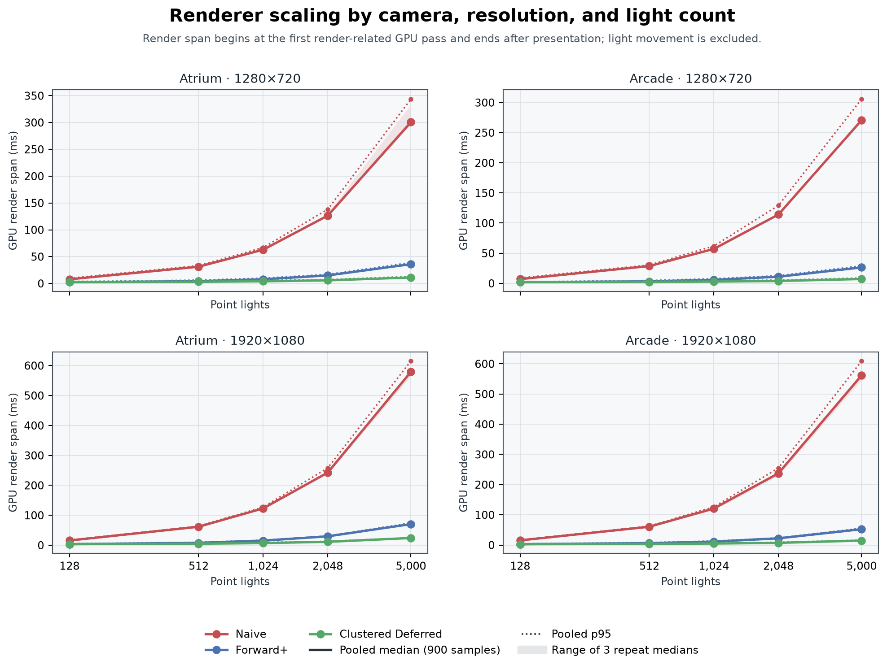
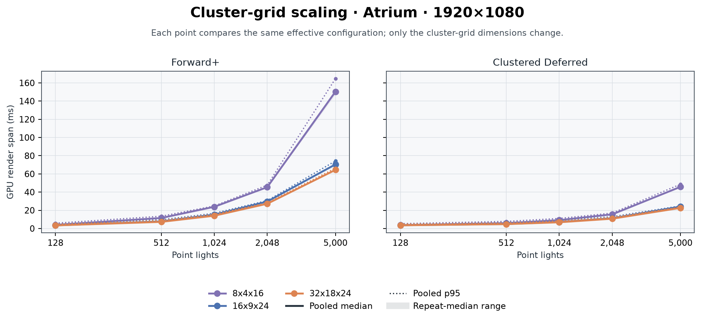
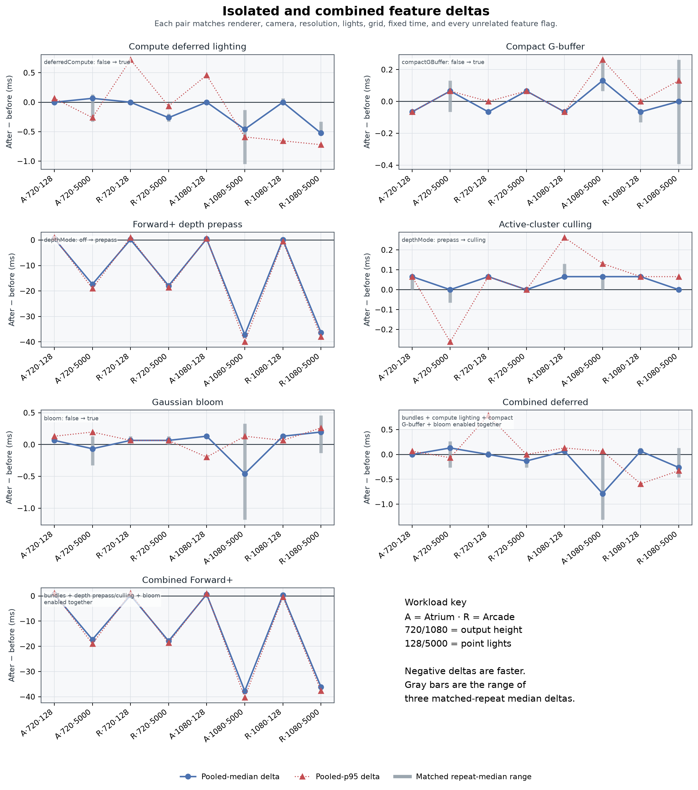
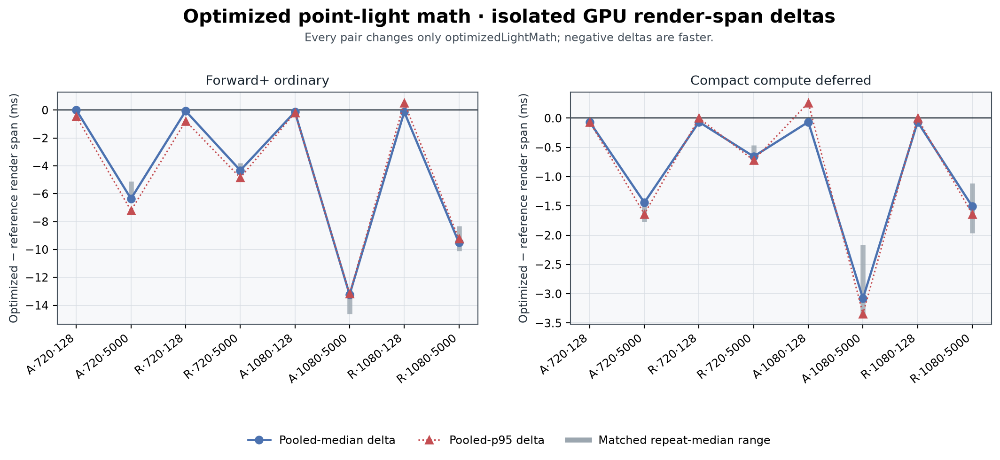
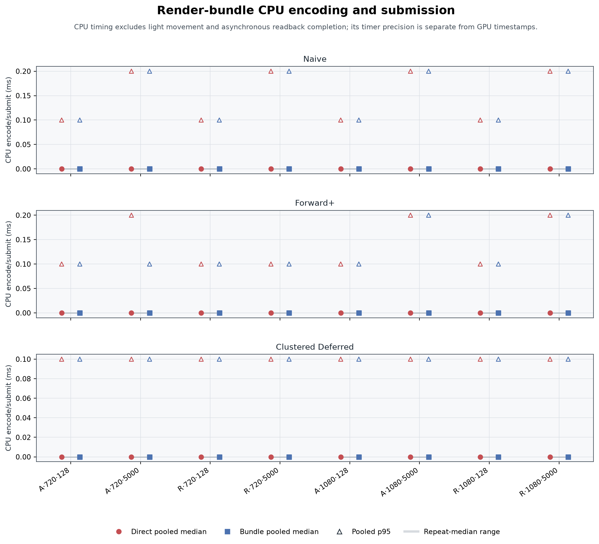
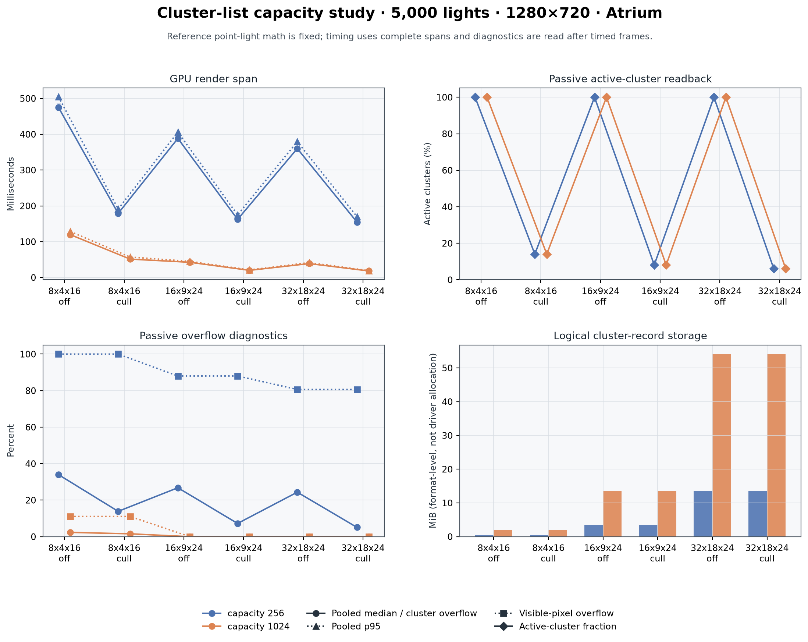
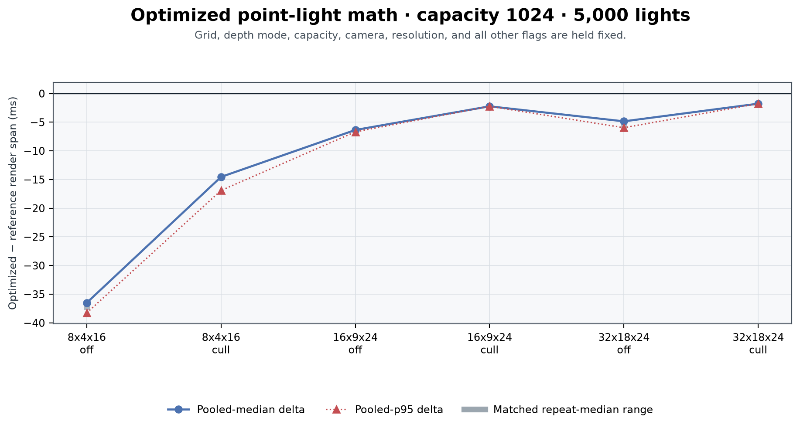

# Performance Analysis

This report evaluates the native WebGPU implementation with milliseconds rather than FPS. It separates measured
observations from architectural explanations and does not treat a single local GPU as representative of all
devices.

## Evidence status and provenance

The full native report passed structural validation and every value below was recomputed from raw samples. No checkpoint or per-repeat summary median is used as a pooled measurement.

| Report | Captured | Scope | Capacity | Cases | Result rows | Raw samples | Rejected |
| --- | --- | --- | ---: | ---: | ---: | ---: | ---: |
| [`benchmark-full.json.gz`](./benchmark-full.json.gz) | 2026-10-13T04:57:42.834Z | full | 1,024 | 176 | 528 | 158,400 | 0 |
| [`capacity-256.json`](./capacity-256.json) | 2026-10-13T01:44:44.122Z | capacity | 256 | 6 | 18 | 5,400 | 0 |
| [`capacity-1024.json`](./capacity-1024.json) | 2026-10-13T02:01:19.544Z | capacity | 1,024 | 12 | 36 | 10,800 | 0 |

Source/build mapping comes from [`build-manifest.json`](./build-manifest.json). Its recorded starter baseline is `a3d826d53a22668a7ae7da23463911303f24a1f5`.

| Report | Manifest build | Source commit | Capacity | Light math | Environment | Observed duration GCD | Validation report | Recorded pre-capture tests |
| --- | --- | --- | ---: | --- | --- | ---: | --- | --- |
| [`benchmark-full.json.gz`](./benchmark-full.json.gz) | capacity1024 | `a54d4089a82844d70fa322721b8403f026188b0c` | 1024 | Selectable preserved reference and early-distance-rejection specialization; final default optimized | Vite development server; native Chrome, Apple M5 | not recorded | [`validation-capacity-1024.json`](./validation-capacity-1024.json) | 35 native GPU checks, zero GPU errors; 22 CPU tests; typecheck and production build passed |
| [`capacity-256.json`](./capacity-256.json) | capacity256 | `ecbaecd005b4bb4a666cbc3bfe98099a5190dd27` | 256 | Reference implementation before the early-distance-rejection specialization | Vite development server; native Chrome, Apple M5 | 65,536 ns | [`validation-capacity-256.json`](./validation-capacity-256.json) | 15 native checks and 13 CPU math tests passed before benchmarking. Expanded validation is in the later build. |
| [`capacity-1024.json`](./capacity-1024.json) | capacity1024 | `a54d4089a82844d70fa322721b8403f026188b0c` | 1024 | Selectable preserved reference and early-distance-rejection specialization; final default optimized | Vite development server; native Chrome, Apple M5 | not recorded | [`validation-capacity-1024.json`](./validation-capacity-1024.json) | 35 native GPU checks, zero GPU errors; 22 CPU tests; typecheck and production build passed |

Performance measurements and their parity evidence in [`validation-capacity-1024.json`](./validation-capacity-1024.json) are tied to source `a54d4089a82844d70fa322721b8403f026188b0c`. Public-native GPU [`validation.json`](./validation.json) is tied to source `39287f3fc59d33444d18046cc0eda2d5de051a00`. Final packaged source is `a256db158cd8bf04a264d1ac2cedd8fa4be803eb`; the 176-case benchmark was not rerun at either later commit. The final manifest snapshot records 55 hashes and exactly 8 changed paths since A54: `src/app_api.ts`, `src/benchmark.ts`, `src/capture.ts`, `src/main.ts`, `src/shaders/shaders.ts`, `src/validation.ts`, `style.css`, and `tests/shader_preprocessing.test.mjs`. All recorded raw `.wgsl` and renderer implementation hashes match the measured source; the host shader loader is intentionally changed.

The release keeps the camera-preset restoration introduced by historical source `d39577f365cf0aa547d9ad60f0dd5aafb8ab2c89`, whose [`validation-ui-restoration.json`](./validation-ui-restoration.json) records 35/35 development checks and zero GPU errors. It also replaces eval-based WGSL interpolation with validated explicit property substitution. Production tree shaking had removed `lightRadius` because its only reference was hidden inside the interpolation string, which generated `undefined` in common and clustering WGSL. No WGSL math, renderer path, resource layout, workload, benchmark protocol, or validation threshold changed.

The [`shader-build-parity.json`](./shader-build-parity.json) proof is committed evidence for source 39287, not relabeled A256 evidence. It reports all 18 exported processed shader strings exactly equal across the measured A54 development capture, fixed development processing, and application-like minified production processing, with zero byte delta. Its actual emitted-main-bundle audit compares 21 unique shader-module strings (18 processed plus 3 direct raw), records 21 exact matches to the original development strings, and records zero mismatches, byte delta, unresolved placeholders, or `undefined` tokens. The proof also links 22 raw WGSL files plus assembly and constant inputs back to A54. Its pre-edit development capture at `f241a2f7c56c7f2126a9112ec59f071ce24ead6b` has an exact shader-tree match and matching Vite/package/TypeScript build-input Git objects to A54. This establishes a one-time host-loader/build correction; it is not a new GPU-math measurement.

The sole packaged change after validation is `style.css`: `object-fit: contain` on `#mainCanvas` preserves the fixed drawing-buffer aspect ratio in differently shaped CSS viewports. The manifest records unchanged CSS canvas width/height, client and drawing-buffer dimensions, all JavaScript and generated-shader bytes, renderer math/layout, and timed paths. No native GPU report or full benchmark is attributed to A256.

The initial public deployment at `f241a2f7c56c7f2126a9112ec59f071ce24ead6b` used D395 code. Its preserved [`validation-production-initial.json`](./validation-production-initial.json), captured at `2026-10-13T05:12:46.047Z`, records 28 failed checks out of 35 and 377 GPU errors from the missing constant. D395 and the later 39287 production-fix source both remain in `releaseHistory`. [`validation.json`](./validation.json), captured at `2026-10-13T05:28:49.046Z`, covers 39287 on the public GitHub Pages HTTPS build in native Chrome on the Apple GPU and passes 35/35 native checks with zero GPU errors; the manifest also records 23 CPU tests, typecheck, and production build passing.

| Report | Declared timestamp metadata | Empirical query-interval granularity |
| --- | --- | --- |
| benchmark-full.json.gz | The numeric quantum is the GCD of observed timestamp tick differences, an empirical resolution bound. Native Metal render-pass spans overlap; use paired total render spans for cost comparisons. | 65,536 ns (0.065536 ms) |
| capacity-256.json | Browser-default timestamps; Chromium commonly quantizes to 0.1 ms. | not recorded |
| capacity-1024.json | The numeric quantum is the GCD of observed timestamp tick differences, an empirical resolution bound. Native Metal render-pass spans overlap; use paired total render spans for cost comparisons. | 65,536 ns (0.065536 ms) |

The numeric reports record an empirical query-interval granularity of **65,536 ns (65.536 µs, 0.065536 ms)**, computed as the GCD of differences between observed GPU query interval timestamps. It is a resolution bound for this capture, not a claimed physical GPU clock period. 1 legacy report(s) lack that numeric field; their declared text is retained above and comparison is permitted only because browser and adapter identity match. The build manifest separately records a GCD over observed timestamp durations for `capacity-256.json`: 65,536 ns (65.536 µs). That is a distinct empirical bound and is not substituted for a missing endpoint-difference field.

Only final named reports are accepted. The loader checks timestamps, scope, protocol, exact repeat coverage, raw
sample counts, finite timings, unique configurations, and agreement between each 300-sample raw repeat and its
stored summary. Case IDs are namespaced by report in memory, which matters because both capacity runs reuse IDs.

## Hardware and validation

| Field | Value |
| --- | --- |
| System | Mac17,2 |
| CPU | Apple M5 · proc 10:4:0:6 |
| GPU | Apple M5, 10 GPU cores |
| Memory | 24 GB |
| Operating system | macOS 27.0.1 |
| Installed Chrome (host inventory) | Google Chrome 155.0.8059.40 |

### Captured browser and adapter identifiers

| Report | Captured report userAgent | Captured report adapterInfo |
| --- | --- | --- |
| [`benchmark-full.json.gz`](./benchmark-full.json.gz) | Mozilla/5.0 (Macintosh; Intel Mac OS X 10_15_7) AppleWebKit/537.36 (KHTML, like Gecko) Chrome/154.0.0.0 Safari/537.36 | vendor=apple; architecture=metal-3; device=(empty); description=(empty) |
| [`capacity-256.json`](./capacity-256.json) | Mozilla/5.0 (Macintosh; Intel Mac OS X 10_15_7) AppleWebKit/537.36 (KHTML, like Gecko) Chrome/154.0.0.0 Safari/537.36 | vendor=apple; architecture=metal-3; device=(empty); description=(empty) |
| [`capacity-1024.json`](./capacity-1024.json) | Mozilla/5.0 (Macintosh; Intel Mac OS X 10_15_7) AppleWebKit/537.36 (KHTML, like Gecko) Chrome/154.0.0.0 Safari/537.36 | vendor=apple; architecture=metal-3; device=(empty); description=(empty) |

These identifiers come from each raw report. The installed Chrome version in `hardware.json` is separate host inventory and is not substituted for `userAgent`. Likewise, the reduced user-agent OS token is not treated as physical operating-system inventory. Reports compared here have matching captured user-agent and adapter identifiers.

The linked [`validation.json`](./validation.json) was captured at 2026-10-13T05:28:49.046Z from the public GitHub Pages HTTPS build in native Chrome on the Apple GPU and records capacity 1024, **35/35 native GPU checks passing**, and **0 recorded GPU errors**. The summaries below use each comparison's declared `gateLabel`; the intentional Arcade camera-change control is not folded into a parity aggregate.

The strict same-path policy covers direct/bundle, compute/fullscreen, ordinary Forward+, and optimized-math parity. It uses absolute `0.0001` plus relative `0.001` raw tolerance over all pixels, requires a raw fraction of at least `0.99999` and displayed fraction of at least `0.99999`, and limits displayed mean RGB error to `0.00392156862745098` (1/255). Across **16 gate-labelled strict checks**, the minimum raw fraction was `1.0` and the largest nonzero raw error was `0.00048828125`. All pixels were inside the raw budget, but the comparisons are not described as bit-exact. The deliberate Arcade camera-change control has raw agreement `0` and no parity gate label, so it is excluded.

Naive versus equal-depth prepass uses the separate coplanar-tie policy with the same raw `0.0001` + `0.001` budget. It recorded **21/129600 raw outliers (0.0162037%)**, agreement `0.999837962962963`, and maximum raw error `0.2379150390625`. These are documented exact-coplanar ties, not data errors. Prepass versus culling remains strict and recorded raw agreement `1`.

Deferred-versus-naive checks use the quantized-G-buffer policy over covered pixels: absolute `0.003` plus relative `0.03`, minimum raw/display fraction `0.99` / `0.99`, displayed mean at most `0.00784313725490196` (2/255), and covered normalized mean at most `0.25`. MRT recorded covered agreement `0.9995806928852286`, maximum raw error `1.25`, and maximum displayed error `0.05615234375`; compact recorded `0.9995015783352716`, `1.625`, and `0.05712890625`. Both selected tests and their declared fraction and mean gates pass; neither path is claimed HDR-exact.

The GPU packing check invoked `packCompactGBuffer`, `unpackCompactNormal`, `unpackCompactAlbedo` and read back **2081 cases** (2048 seeded plus known stress cases). Maximum angular error was `0.0032716410063289058` degrees, maximum RGBA error `0.0019608139991760254`, and maximum unit-length error `1.0030822550355367e-07`. These are correctness measurements, not renderer timings.

The 5000-light overflow fixture recorded maximum raw RGB error `0` over 129600 total and 9658 lit covered pixels with finite output (`finite=true`). These conditions verify one complete all-light evaluation per overflowing invocation without a partial-list double add. The active-mask fixture covered 129600 visible pixels with 0 missing, 278/3456 active clusters, capacity 1024, and overflow-pixel fraction `0`. Those 480×270 fixture values must not be imputed to unrelated screenshots.

Four bloom fixtures use fixed-order Naive output as input to shared post-processing. Positive bloom changed presentation while source-HDR maximum error was `0`; strength zero recorded `0` changed pixels and `0` changed RGB bytes, while a huge threshold recorded `0` changed pixels and `0` changed RGB bytes; zero lights remained black through HDR, bloom, and presentation.

The preserved [`validation-initial-1024.json`](./validation-initial-1024.json), captured at 2026-10-13T01:47:09.203Z, failed those two exact presentation checks by 1 changed pixel / 1 RGB byte and 1 changed pixel / 1 RGB byte, each at one LSB. Parallel cluster-list summation had changed the input between frames. The reviewed fixture correction isolated post-processing with the fixed-order Naive source; it did not loosen exact byte gates or change a GPU kernel.

The independent command `npm test` covers the CPU suite; its result is recorded separately in `build-manifest.json`. Validation establishes declared correctness bounds, not performance speedups.

## Measurement protocol

Each effective configuration uses 120 warmup frames followed by 300 valid frames, repeated three times in
forward/reversed/forward case order. Lights are frozen at time 1000 and their colors come from fixed xorshift seed
`0x6d2b79f5`. The full sweep covers 1280×720 and 1920×1080, Atrium and Arcade cameras, and 128, 512, 1024, 2048,
and 5000 lights. Cluster-grid scaling uses 1920×1080 Atrium; isolated features use 128 and 5000 lights across both
cameras and resolutions. The 176-case full plan contains 160 inherited configurations with optimized point-light
math enabled plus 16 isolated reference-kernel configurations. Capacity 256 contains six legacy reference cases;
capacity 1024 contains the same six reference cases plus six optimized-kernel cases.

Pooled medians and p95 values are recomputed from all 900 raw samples per case using
`sorted[floor(q × n)]`: indices 450 and 855. Shaded bands/bars show the range of the three independently recomputed
300-sample repeat medians. They are run-variation summaries, not fabricated confidence intervals, and pooling does
not make the 900 temporally adjacent frames independent observations.

`renderMs` spans from the first render-related GPU pass through presentation and excludes light movement. `gpuMs`
spans light movement through presentation, including command-scheduling gaps. `cpuMs` covers render draw encoding
and submission while excluding light movement and asynchronous readback completion/processing. Per-pass timestamps
are overlapping diagnostic intervals on this native pipeline, not exclusive stage costs; they must never be added
or substituted for paired complete `renderMs` differences. Profiling uses six asynchronous slots with 64 timestamp
entries each; normal frames do not synchronously wait for the queue. When present, numeric `timestampQuantumNs`
supplies the empirical GPU query-interval resolution bound shown in provenance above; it is not a universal
hardware-clock claim. A below-bound or zero pass value does not establish zero cost. CPU timing uses a separate
timer and does not inherit that precision claim.

### Raw timestamp-interval audit

| Report | Frames with intervals | Every interval end ≥ start | renderMs equals logical first-start → last-end | Frames with overlapping render intervals |
| --- | ---: | ---: | ---: | ---: |
| [`benchmark-full.json.gz`](./benchmark-full.json.gz) | 158,400/158,400 | 158,400/158,400 | 158,400/158,400 | 158,400/158,400 |
| [`capacity-1024.json`](./capacity-1024.json) | 10,800/10,800 | 10,800/10,800 | 10,800/10,800 | 10,800/10,800 |

The render-span check uses capture order: the first non-light-movement interval start through the final recorded interval end. It does not replace that start with the chronologically earliest timestamp, because native intervals overlap. The overlap column is direct evidence that labeled pass spans are not exclusive costs and must not be added.

Passive diagnostics—active clusters, overflow, depth coverage, and logical storage—are read once after each timed
repeat and therefore sit outside the 300 measured frames. Bloom’s implementation defaults are threshold 1 and
strength 0.2. New full and capacity-1024 reports record both values in every effective configuration. The legacy
capacity-256 report omits them, so the loader canonicalizes those missing fields to the same defaults before exact
configuration matching.

## Measured results

### Renderer comparison

| Camera | Resolution | Lights | Naive ms | Forward+ ms | Deferred ms | Lowest median |
| --- | --- | ---: | ---: | ---: | ---: | --- |
| Atrium | 1280×720 | 128 | 7.799 | 2.294 | 2.556 | forward+ |
| Atrium | 1280×720 | 5,000 | 300.7 | 35.98 | 11.14 | clustered deferred |
| Arcade | 1280×720 | 128 | 7.078 | 1.835 | 1.966 | forward+ |
| Arcade | 1280×720 | 5,000 | 270.7 | 26.41 | 7.209 | clustered deferred |
| Atrium | 1920×1080 | 128 | 15.66 | 3.408 | 3.539 | forward+ |
| Atrium | 1920×1080 | 5,000 | 579.1 | 70.45 | 24.05 | clustered deferred |
| Arcade | 1920×1080 | 128 | 15.40 | 2.753 | 2.818 | forward+ |
| Arcade | 1920×1080 | 5,000 | 561.7 | 52.36 | 14.75 | clustered deferred |

In this capture, Forward+ had the lowest pooled median in **4/4** 128-light base cases; clustered deferred had the lowest in **16/16** base cases from 512 through 5,000 lights. Naive forward was lowest in **0/20**. At 5,000 lights, the four deferred medians ranged from 7.209 to 24.05 ms, versus 26.41–70.45 ms for Forward+ and 270.7–579.1 ms for naive forward. Those rankings describe only these cameras, resolutions, and renderer defaults.

The table deliberately shows both low and high light counts for every camera/resolution pair; the figure contains
all five counts plus pooled p95 and repeat-median ranges. Naive forward performs the complete light loop for every
surviving fragment, so its fragment cost grows directly with both visible work and light count. Forward+ pays to
transform lights and build lists, then shades only a cluster's candidates. Clustered deferred uses those same lists
but moves lighting to a screen-space pass after writing material/geometry data. Which clustered renderer wins is an
observed workload result, not a universal ordering: Forward+ can avoid G-buffer traffic, while deferred shades each
covered pixel once and decouples geometry submission from lighting.

### Cluster-grid scaling

| Renderer | Lights | Lowest-median grid | Median ms |
| --- | ---: | --- | ---: |
| Forward+ | 128 | 32x18x24 | 3.342 |
| Forward+ | 512 | 32x18x24 | 7.274 |
| Forward+ | 1,024 | 32x18x24 | 14.02 |
| Forward+ | 2,048 | 32x18x24 | 27.20 |
| Forward+ | 5,000 | 32x18x24 | 64.42 |
| Clustered Deferred | 128 | 32x18x24 | 3.473 |
| Clustered Deferred | 512 | 32x18x24 | 4.784 |
| Clustered Deferred | 1,024 | 32x18x24 | 6.816 |
| Clustered Deferred | 2,048 | 32x18x24 | 10.75 |
| Clustered Deferred | 5,000 | 32x18x24 | 22.61 |

The finest measured grid, `32x18x24`, had the lowest pooled median in **10/10** renderer/light-count pairs. Relative to `8x4x16`, its median deltas ranged from -85.918 to -0.262 ms (-57.1% to -7.0%). This does not imply that grids finer than the tested range would continue to win.

The grid changes two opposing costs. Finer grids generally shorten candidate lists and reduce false-positive light
tests during shading, but create more records, more sphere/AABB intersection work, and more memory traffic. The
clusters use logarithmic depth slices between 0.1 and 1000. Each frustum cell is represented by a conservative
view-space AABB, so a sphere may intersect the AABB without intersecting the exact frustum: that is a safe false
positive. Tighter geometric tests could reduce list lengths, but their extra clustering ALU and branch cost would
need measurement.

### Isolated feature deltas

Negative deltas mean the feature was faster. “Best” and “worst” below are simply the minimum and maximum observed
pooled-median deltas across the eight fixed workloads; they are not confidence bounds.

| Feature | Median workload Δ ms | Best observed Δ | Worst observed Δ | Faster cases |
| --- | ---: | --- | --- | ---: |
| Compute deferred lighting | +0.000 | -0.524 · Arcade, 1920×1080, 5,000 lights | +0.066 · Atrium, 1280×720, 5,000 lights | 3/8 |
| Compact G-buffer | -0.033 | -0.066 · Arcade, 1920×1080, 128 lights | +0.131 · Atrium, 1920×1080, 5,000 lights | 4/8 |
| Forward+ depth prepass | -8.618 | -37.224 · Atrium, 1920×1080, 5,000 lights | +0.590 · Atrium, 1280×720, 128 lights | 4/8 |
| Active-cluster culling | +0.066 | +0.000 · Atrium, 1280×720, 5,000 lights | +0.066 · Atrium, 1920×1080, 5,000 lights | 0/8 |
| Gaussian bloom | +0.066 | -0.459 · Atrium, 1920×1080, 5,000 lights | +0.197 · Arcade, 1920×1080, 5,000 lights | 2/8 |
| Combined deferred | +0.000 | -0.786 · Atrium, 1920×1080, 5,000 lights | +0.131 · Atrium, 1280×720, 5,000 lights | 3/8 |
| Combined Forward+ | -8.487 | -37.749 · Atrium, 1920×1080, 5,000 lights | +0.721 · Atrium, 1280×720, 128 lights | 4/8 |

Direction counts make the repeat evidence explicit:

| Feature | Pooled median lower / equal / higher | Repeat ranges below / crossing-or-touching / above zero |
| --- | ---: | ---: |
| Compute deferred lighting | 3 / 4 / 1 | 3 / 5 / 0 |
| Compact G-buffer | 4 / 1 / 3 | 4 / 2 / 2 |
| Forward+ depth prepass | 4 / 0 / 4 | 4 / 0 / 4 |
| Active-cluster culling | 0 / 3 / 5 | 0 / 4 / 4 |
| Gaussian bloom | 2 / 0 / 6 | 0 / 4 / 4 |
| Combined deferred | 3 / 2 / 3 | 0 / 6 / 2 |
| Combined Forward+ | 4 / 0 / 4 | 4 / 0 / 4 |

The depth prepass produced the clearest workload split: all four 5,000-light medians fell by 17.37–37.22 ms, while all four 128-light medians rose by 0.131–0.590 ms; every corresponding repeat range stayed on the same side of zero. Active-cluster culling, measured strictly against prepass, produced no lower pooled median (3 unchanged and 5 higher); its largest increase was 0.066 ms, one recorded timestamp step.

Compute deferred lighting had 3/8 repeat ranges wholly below zero and the other five crossed or touched zero. Compact storage was similarly mixed, with pooled-median deltas from -0.066 to +0.131 ms. Bloom increased six pooled medians, but none of its two negative median deltas had a repeat range wholly below zero; 4 ranges stayed above zero. These small, quantized, or crossing-range results do not establish a general speedup. The combined rows remain composite observations rather than attribution to any one flag.

The two combined rows are intentionally *not* isolated attribution. Combined deferred changes bundles, compute
lighting, compact storage, and bloom together. Combined Forward+ changes bundles, depth mode from off to culling,
and bloom together. Their baselines are the corresponding ordinary renderer with every changed flag disabled.
All standard full-benchmark configurations use `optimizedLightMath=true`, so no unrelated kernel change enters
these pairs.

Compute deferred lighting: all paired GPU render spans

| Workload | Before median ms | Before p95 ms | After median ms | After p95 ms | Median Δ ms | Matched-repeat median Δ range |
| --- | ---: | ---: | ---: | ---: | ---: | --- |
| Atrium, 1280×720, 128 lights | 2.556 | 3.867 | 2.556 | 3.932 | +0.000 | +0.000 to +0.000 |
| Atrium, 1280×720, 5,000 lights | 11.14 | 13.11 | 11.21 | 12.85 | +0.066 | -0.328 to +0.131 |
| Arcade, 1280×720, 128 lights | 1.966 | 2.621 | 1.966 | 3.342 | +0.000 | +0.000 to +0.000 |
| Arcade, 1280×720, 5,000 lights | 7.209 | 8.978 | 6.947 | 8.913 | -0.262 | -0.328 to -0.197 |
| Atrium, 1920×1080, 128 lights | 3.539 | 4.915 | 3.539 | 5.374 | +0.000 | +0.000 to +0.000 |
| Atrium, 1920×1080, 5,000 lights | 24.05 | 24.84 | 23.59 | 24.25 | -0.459 | -1.049 to -0.131 |
| Arcade, 1920×1080, 128 lights | 2.818 | 4.260 | 2.818 | 3.604 | +0.000 | +0.000 to +0.066 |
| Arcade, 1920×1080, 5,000 lights | 14.75 | 16.38 | 14.22 | 15.66 | -0.524 | -0.524 to -0.328 |

Compact G-buffer: all paired GPU render spans

| Workload | Before median ms | Before p95 ms | After median ms | After p95 ms | Median Δ ms | Matched-repeat median Δ range |
| --- | ---: | ---: | ---: | ---: | ---: | --- |
| Atrium, 1280×720, 128 lights | 2.556 | 3.932 | 2.490 | 3.867 | -0.066 | -0.066 to -0.066 |
| Atrium, 1280×720, 5,000 lights | 11.21 | 12.85 | 11.27 | 12.91 | +0.066 | -0.066 to +0.131 |
| Arcade, 1280×720, 128 lights | 1.966 | 3.342 | 1.901 | 3.342 | -0.066 | -0.066 to -0.066 |
| Arcade, 1280×720, 5,000 lights | 6.947 | 8.913 | 7.012 | 8.978 | +0.066 | +0.066 to +0.066 |
| Atrium, 1920×1080, 128 lights | 3.539 | 5.374 | 3.473 | 5.308 | -0.066 | -0.066 to -0.066 |
| Atrium, 1920×1080, 5,000 lights | 23.59 | 24.25 | 23.72 | 24.51 | +0.131 | +0.066 to +0.262 |
| Arcade, 1920×1080, 128 lights | 2.818 | 3.604 | 2.753 | 3.604 | -0.066 | -0.131 to -0.066 |
| Arcade, 1920×1080, 5,000 lights | 14.22 | 15.66 | 14.22 | 15.79 | +0.000 | -0.393 to +0.262 |

Forward+ depth prepass: all paired GPU render spans

| Workload | Before median ms | Before p95 ms | After median ms | After p95 ms | Median Δ ms | Matched-repeat median Δ range |
| --- | ---: | ---: | ---: | ---: | ---: | --- |
| Atrium, 1280×720, 128 lights | 2.294 | 3.277 | 2.884 | 4.260 | +0.590 | +0.590 to +0.590 |
| Atrium, 1280×720, 5,000 lights | 35.98 | 38.86 | 18.61 | 19.86 | -17.367 | -17.302 to -17.170 |
| Arcade, 1280×720, 128 lights | 1.835 | 2.490 | 2.032 | 3.473 | +0.197 | +0.197 to +0.197 |
| Arcade, 1280×720, 5,000 lights | 26.41 | 28.97 | 8.454 | 10.29 | -17.957 | -18.153 to -17.760 |
| Atrium, 1920×1080, 128 lights | 3.408 | 4.850 | 3.867 | 5.505 | +0.459 | +0.459 to +0.524 |
| Atrium, 1920×1080, 5,000 lights | 70.45 | 74.19 | 33.23 | 34.21 | -37.224 | -37.552 to -36.962 |
| Arcade, 1920×1080, 128 lights | 2.753 | 4.260 | 2.884 | 3.736 | +0.131 | +0.066 to +0.131 |
| Arcade, 1920×1080, 5,000 lights | 52.36 | 55.57 | 16.06 | 17.56 | -36.307 | -37.421 to -35.717 |

Active-cluster culling: all paired GPU render spans

| Workload | Before median ms | Before p95 ms | After median ms | After p95 ms | Median Δ ms | Matched-repeat median Δ range |
| --- | ---: | ---: | ---: | ---: | ---: | --- |
| Atrium, 1280×720, 128 lights | 2.884 | 4.260 | 2.949 | 4.325 | +0.066 | +0.000 to +0.066 |
| Atrium, 1280×720, 5,000 lights | 18.61 | 19.86 | 18.61 | 19.60 | +0.000 | -0.066 to +0.000 |
| Arcade, 1280×720, 128 lights | 2.032 | 3.473 | 2.097 | 3.539 | +0.066 | +0.066 to +0.066 |
| Arcade, 1280×720, 5,000 lights | 8.454 | 10.29 | 8.454 | 10.29 | +0.000 | +0.000 to +0.000 |
| Atrium, 1920×1080, 128 lights | 3.867 | 5.505 | 3.932 | 5.767 | +0.066 | +0.066 to +0.131 |
| Atrium, 1920×1080, 5,000 lights | 33.23 | 34.21 | 33.29 | 34.34 | +0.066 | +0.000 to +0.066 |
| Arcade, 1920×1080, 128 lights | 2.884 | 3.736 | 2.949 | 3.801 | +0.066 | +0.066 to +0.066 |
| Arcade, 1920×1080, 5,000 lights | 16.06 | 17.56 | 16.06 | 17.63 | +0.000 | +0.066 to +0.066 |

Gaussian bloom: all paired GPU render spans

| Workload | Before median ms | Before p95 ms | After median ms | After p95 ms | Median Δ ms | Matched-repeat median Δ range |
| --- | ---: | ---: | ---: | ---: | ---: | --- |
| Atrium, 1280×720, 128 lights | 2.490 | 3.867 | 2.556 | 3.998 | +0.066 | +0.066 to +0.131 |
| Atrium, 1280×720, 5,000 lights | 11.27 | 12.91 | 11.21 | 13.11 | -0.066 | -0.328 to +0.131 |
| Arcade, 1280×720, 128 lights | 1.901 | 3.342 | 1.966 | 3.408 | +0.066 | +0.066 to +0.131 |
| Arcade, 1280×720, 5,000 lights | 7.012 | 8.978 | 7.078 | 9.044 | +0.066 | +0.000 to +0.131 |
| Atrium, 1920×1080, 128 lights | 3.473 | 5.308 | 3.604 | 5.112 | +0.131 | +0.131 to +0.131 |
| Atrium, 1920×1080, 5,000 lights | 23.72 | 24.51 | 23.27 | 24.64 | -0.459 | -1.180 to +0.328 |
| Arcade, 1920×1080, 128 lights | 2.753 | 3.604 | 2.884 | 3.670 | +0.131 | +0.131 to +0.131 |
| Arcade, 1920×1080, 5,000 lights | 14.22 | 15.79 | 14.42 | 16.06 | +0.197 | -0.131 to +0.459 |

Combined deferred: all paired GPU render spans

| Workload | Before median ms | Before p95 ms | After median ms | After p95 ms | Median Δ ms | Matched-repeat median Δ range |
| --- | ---: | ---: | ---: | ---: | ---: | --- |
| Atrium, 1280×720, 128 lights | 2.556 | 3.867 | 2.556 | 3.932 | +0.000 | +0.000 to +0.066 |
| Atrium, 1280×720, 5,000 lights | 11.14 | 13.11 | 11.27 | 13.04 | +0.131 | -0.262 to +0.262 |
| Arcade, 1280×720, 128 lights | 1.966 | 2.621 | 1.966 | 3.408 | +0.000 | +0.000 to +0.066 |
| Arcade, 1280×720, 5,000 lights | 7.209 | 8.978 | 7.078 | 8.978 | -0.131 | -0.262 to +0.000 |
| Atrium, 1920×1080, 128 lights | 3.539 | 4.915 | 3.604 | 5.046 | +0.066 | +0.066 to +0.066 |
| Atrium, 1920×1080, 5,000 lights | 24.05 | 24.84 | 23.27 | 24.90 | -0.786 | -1.311 to +0.000 |
| Arcade, 1920×1080, 128 lights | 2.818 | 4.260 | 2.884 | 3.670 | +0.066 | +0.066 to +0.131 |
| Arcade, 1920×1080, 5,000 lights | 14.75 | 16.38 | 14.48 | 16.06 | -0.262 | -0.459 to +0.131 |

Combined Forward+: all paired GPU render spans

| Workload | Before median ms | Before p95 ms | After median ms | After p95 ms | Median Δ ms | Matched-repeat median Δ range |
| --- | ---: | ---: | ---: | ---: | ---: | --- |
| Atrium, 1280×720, 128 lights | 2.294 | 3.277 | 3.015 | 4.391 | +0.721 | +0.655 to +0.721 |
| Atrium, 1280×720, 5,000 lights | 35.98 | 38.86 | 18.68 | 19.86 | -17.302 | -17.302 to -17.105 |
| Arcade, 1280×720, 128 lights | 1.835 | 2.490 | 2.163 | 3.604 | +0.328 | +0.328 to +0.328 |
| Arcade, 1280×720, 5,000 lights | 26.41 | 28.97 | 8.520 | 10.35 | -17.891 | -18.088 to -17.695 |
| Atrium, 1920×1080, 128 lights | 3.408 | 4.850 | 4.063 | 5.767 | +0.655 | +0.655 to +0.721 |
| Atrium, 1920×1080, 5,000 lights | 70.45 | 74.19 | 32.70 | 33.88 | -37.749 | -38.339 to -37.028 |
| Arcade, 1920×1080, 128 lights | 2.753 | 4.260 | 3.080 | 3.867 | +0.328 | +0.262 to +0.328 |
| Arcade, 1920×1080, 5,000 lights | 52.36 | 55.57 | 16.25 | 17.96 | -36.110 | -37.224 to -35.455 |

### Optimized point-light math

The full report adds reference-kernel cases only for ordinary Forward+ and compact compute deferred. Each of the
16 pairs holds camera, resolution, light count, renderer path, grid, and every other feature flag fixed. This is an
optimization-effort comparison, not an additional extra-credit feature. The optimized path rejects
`d² >= radius²` before square-root, attenuation, and light/normal work; uses `(1 - (d²/r²)²) / d²` attenuation; and
normalizes the surface normal once before the light loop. The reference path retains the original helper body.
Native parity tests assess `f32` rounding, and timing alone does not attribute a delta to one transformation.

The optimized kernel recorded a lower pooled median in **15/16** pairs, an unchanged median in **1/16**, and no higher median. All eight 5,000-light pairs fell by 0.655–13.24 ms, with **8/8** matched-repeat ranges wholly below zero. Across all light counts, 13/16 repeat ranges stayed below zero; the remaining 3 touched or crossed zero.

Forward+ ordinary: reference versus optimized point-light math

| Workload | Before median ms | Before p95 ms | After median ms | After p95 ms | Median Δ ms | Matched-repeat median Δ range |
| --- | ---: | ---: | ---: | ---: | ---: | --- |
| Atrium, 1280×720, 128 lights | 2.294 | 3.736 | 2.294 | 3.277 | +0.000 | +0.000 to +0.000 |
| Atrium, 1280×720, 5,000 lights | 42.34 | 46.07 | 35.98 | 38.86 | -6.357 | -6.554 to -5.112 |
| Arcade, 1280×720, 128 lights | 1.901 | 3.277 | 1.835 | 2.490 | -0.066 | -0.066 to -0.066 |
| Arcade, 1280×720, 5,000 lights | 30.74 | 33.82 | 26.41 | 28.97 | -4.325 | -4.522 to -3.801 |
| Atrium, 1920×1080, 128 lights | 3.539 | 5.046 | 3.408 | 4.850 | -0.131 | -0.131 to -0.131 |
| Atrium, 1920×1080, 5,000 lights | 83.69 | 87.36 | 70.45 | 74.19 | -13.238 | -14.615 to -12.911 |
| Arcade, 1920×1080, 128 lights | 2.884 | 3.736 | 2.753 | 4.260 | -0.131 | -0.131 to -0.066 |
| Arcade, 1920×1080, 5,000 lights | 61.87 | 64.82 | 52.36 | 55.57 | -9.503 | -10.093 to -8.323 |

Compact compute deferred: reference versus optimized point-light math

| Workload | Before median ms | Before p95 ms | After median ms | After p95 ms | Median Δ ms | Matched-repeat median Δ range |
| --- | ---: | ---: | ---: | ---: | ---: | --- |
| Atrium, 1280×720, 128 lights | 2.556 | 3.932 | 2.490 | 3.867 | -0.066 | -0.066 to +0.000 |
| Atrium, 1280×720, 5,000 lights | 12.71 | 14.55 | 11.27 | 12.91 | -1.442 | -1.769 to -1.376 |
| Arcade, 1280×720, 128 lights | 1.966 | 3.342 | 1.901 | 3.342 | -0.066 | -0.066 to +0.000 |
| Arcade, 1280×720, 5,000 lights | 7.668 | 9.699 | 7.012 | 8.978 | -0.655 | -0.655 to -0.459 |
| Atrium, 1920×1080, 128 lights | 3.539 | 5.046 | 3.473 | 5.308 | -0.066 | -0.066 to -0.066 |
| Atrium, 1920×1080, 5,000 lights | 26.80 | 27.85 | 23.72 | 24.51 | -3.080 | -3.342 to -2.163 |
| Arcade, 1920×1080, 128 lights | 2.818 | 3.604 | 2.753 | 3.604 | -0.066 | -0.066 to -0.066 |
| Arcade, 1920×1080, 5,000 lights | 15.73 | 17.43 | 14.22 | 15.79 | -1.507 | -1.966 to -1.114 |

### Representative whole-frame GPU spans

`gpuMs` includes light movement through presentation, while `renderMs` begins after light movement. They are
reported separately here and are never reconstructed from pass intervals.

| Renderer | Lights | renderMs median | renderMs p95 | gpuMs median | gpuMs p95 |
| --- | ---: | ---: | ---: | ---: | ---: |
| Naive | 128 | 15.66 | 17.10 | 15.86 | 17.37 |
| Forward+ | 128 | 3.408 | 4.850 | 3.408 | 4.915 |
| Clustered Deferred | 128 | 3.539 | 4.915 | 3.539 | 4.981 |
| Naive | 5,000 | 579.1 | 615.3 | 579.3 | 616.0 |
| Forward+ | 5,000 | 70.45 | 74.19 | 70.45 | 74.51 |
| Clustered Deferred | 5,000 | 24.05 | 24.84 | 24.12 | 25.03 |

### Render bundles

| Renderer | Median workload CPU Δ ms | Best observed CPU Δ | Worst observed CPU Δ | GPU regressions |
| --- | ---: | --- | --- | ---: |
| Naive | +0.000 | +0.000 · Atrium, 1280×720, 128 lights | +0.000 · Atrium, 1280×720, 128 lights | 5/8 |
| Forward+ | +0.000 | +0.000 · Atrium, 1280×720, 128 lights | +0.000 · Atrium, 1280×720, 128 lights | 4/8 |
| Clustered Deferred | +0.000 | +0.000 · Atrium, 1280×720, 128 lights | +0.000 · Atrium, 1280×720, 128 lights | 1/8 |

Bundles cache pipeline, bindings, buffers, and draw commands, targeting host-side encoding overhead. They do not
promise lower GPU time, and the last column reports how often the pooled GPU render median increased. Browser timer
precision can produce a zero CPU median; the CPU timer is separate from the GPU timestamp clock.

The browser CPU timer resolved no median change in **24/24** pairs. CPU p95 was lower in 1/24 and unchanged in 23/24, so this capture does not demonstrate a median CPU benefit. GPU render medians were lower/equal/higher in 5 / 9 / 10 pairs. The largest regression was +59.179 ms for Naive, Arcade, 1920×1080, 5,000 lights; its matched-repeat range was +0.721 to +77.857 ms, showing substantial run variation rather than a guaranteed bundle cost.

All direct/bundle CPU timings and paired GPU render medians

| Renderer | Workload | Direct CPU median ms | Direct CPU p95 ms | Bundle CPU median ms | Bundle CPU p95 ms | Direct GPU median ms | Direct GPU p95 ms | Bundle GPU median ms | Bundle GPU p95 ms | GPU matched-repeat median Δ range |
| --- | --- | ---: | ---: | ---: | ---: | ---: | ---: | ---: | ---: | --- |
| Naive | Atrium, 1280×720, 128 lights | 0.000 | 0.100 | 0.000 | 0.100 | 7.799 | 9.765 | 7.799 | 9.437 | +0.000 to +0.197 |
| Naive | Atrium, 1280×720, 5,000 lights | 0.000 | 0.200 | 0.000 | 0.200 | 300.7 | 343.7 | 295.5 | 331.0 | -41.615 to +0.786 |
| Naive | Arcade, 1280×720, 128 lights | 0.000 | 0.100 | 0.000 | 0.100 | 7.078 | 8.978 | 7.143 | 9.044 | -0.131 to +0.197 |
| Naive | Arcade, 1280×720, 5,000 lights | 0.000 | 0.200 | 0.000 | 0.200 | 270.7 | 305.8 | 272.2 | 309.1 | -2.687 to +3.146 |
| Naive | Atrium, 1920×1080, 128 lights | 0.000 | 0.100 | 0.000 | 0.100 | 15.66 | 17.10 | 15.79 | 17.37 | -0.524 to +0.393 |
| Naive | Atrium, 1920×1080, 5,000 lights | 0.000 | 0.200 | 0.000 | 0.200 | 579.1 | 615.3 | 582.2 | 660.6 | -3.342 to +86.770 |
| Naive | Arcade, 1920×1080, 128 lights | 0.000 | 0.100 | 0.000 | 0.100 | 15.40 | 16.91 | 14.81 | 16.38 | -0.721 to +0.131 |
| Naive | Arcade, 1920×1080, 5,000 lights | 0.000 | 0.200 | 0.000 | 0.200 | 561.7 | 609.3 | 620.9 | 641.7 | +0.721 to +77.857 |
| Forward+ | Atrium, 1280×720, 128 lights | 0.000 | 0.100 | 0.000 | 0.100 | 2.294 | 3.277 | 2.294 | 3.736 | +0.000 to +0.000 |
| Forward+ | Atrium, 1280×720, 5,000 lights | 0.000 | 0.200 | 0.000 | 0.100 | 35.98 | 38.86 | 36.04 | 39.12 | -0.459 to +0.197 |
| Forward+ | Arcade, 1280×720, 128 lights | 0.000 | 0.100 | 0.000 | 0.100 | 1.835 | 2.490 | 1.835 | 3.277 | +0.000 to +0.066 |
| Forward+ | Arcade, 1280×720, 5,000 lights | 0.000 | 0.100 | 0.000 | 0.100 | 26.41 | 28.97 | 26.54 | 29.23 | +0.066 to +0.197 |
| Forward+ | Atrium, 1920×1080, 128 lights | 0.000 | 0.100 | 0.000 | 0.100 | 3.408 | 4.850 | 3.408 | 5.243 | -0.066 to +0.000 |
| Forward+ | Atrium, 1920×1080, 5,000 lights | 0.000 | 0.200 | 0.000 | 0.200 | 70.45 | 74.19 | 70.06 | 73.60 | -0.524 to +0.721 |
| Forward+ | Arcade, 1920×1080, 128 lights | 0.000 | 0.100 | 0.000 | 0.100 | 2.753 | 4.260 | 2.818 | 3.604 | -0.066 to +0.000 |
| Forward+ | Arcade, 1920×1080, 5,000 lights | 0.000 | 0.200 | 0.000 | 0.200 | 52.36 | 55.57 | 52.49 | 54.98 | -0.918 to +0.328 |
| Clustered Deferred | Atrium, 1280×720, 128 lights | 0.000 | 0.100 | 0.000 | 0.100 | 2.556 | 3.867 | 2.556 | 3.932 | -0.066 to +0.000 |
| Clustered Deferred | Atrium, 1280×720, 5,000 lights | 0.000 | 0.100 | 0.000 | 0.100 | 11.14 | 13.11 | 11.40 | 13.11 | -0.066 to +0.262 |
| Clustered Deferred | Arcade, 1280×720, 128 lights | 0.000 | 0.100 | 0.000 | 0.100 | 1.966 | 2.621 | 1.966 | 3.342 | +0.000 to +0.000 |
| Clustered Deferred | Arcade, 1280×720, 5,000 lights | 0.000 | 0.100 | 0.000 | 0.100 | 7.209 | 8.978 | 7.209 | 9.110 | -0.066 to +0.131 |
| Clustered Deferred | Atrium, 1920×1080, 128 lights | 0.000 | 0.100 | 0.000 | 0.100 | 3.539 | 4.915 | 3.539 | 5.112 | +0.000 to +0.000 |
| Clustered Deferred | Atrium, 1920×1080, 5,000 lights | 0.000 | 0.100 | 0.000 | 0.100 | 24.05 | 24.84 | 23.59 | 24.51 | -1.245 to -0.197 |
| Clustered Deferred | Arcade, 1920×1080, 128 lights | 0.000 | 0.100 | 0.000 | 0.100 | 2.818 | 4.260 | 2.818 | 3.604 | +0.000 to +0.066 |
| Clustered Deferred | Arcade, 1920×1080, 5,000 lights | 0.000 | 0.100 | 0.000 | 0.100 | 14.75 | 16.38 | 14.48 | 16.12 | -0.393 to +0.262 |

### Capacity comparison

| Grid | Depth | 256 median ms | 256 p95 ms | 1024 median ms | 1024 p95 ms | Δ median ms | Matched-repeat Δ range ms | 256 visible overflow | 1024 visible overflow | 256 logical MiB | 1024 logical MiB |
| --- | --- | ---: | ---: | ---: | ---: | ---: | --- | ---: | ---: | ---: | ---: |
| 8x4x16 | off | 475.1 | 504.6 | 119.5 | 128.3 | -355.598 | -368.050 to -348.979 | 100.00% | 11.07% | 0.50 | 2.00 |
| 8x4x16 | culling | 179.0 | 191.1 | 51.31 | 57.08 | -127.664 | -133.431 to -124.781 | 100.00% | 11.07% | 0.50 | 2.00 |
| 16x9x24 | off | 388.4 | 406.1 | 42.47 | 45.09 | -345.899 | -350.028 to -343.409 | 88.01% | 0.00% | 3.40 | 13.53 |
| 16x9x24 | culling | 162.3 | 174.7 | 19.99 | 21.17 | -142.279 | -145.162 to -139.788 | 88.01% | 0.00% | 3.40 | 13.53 |
| 32x18x24 | off | 360.1 | 379.4 | 38.80 | 41.55 | -321.257 | -321.978 to -319.750 | 80.62% | 0.00% | 13.61 | 54.11 |
| 32x18x24 | culling | 154.6 | 169.9 | 18.22 | 19.20 | -136.380 | -141.820 to -133.235 | 80.62% | 0.00% | 13.61 | 54.11 |

#### Measured capacity findings

These six pairs use 1280×720 Atrium, 5,000 frozen lights, bundles enabled, time 1000, seed `0x6d2b79f5`, and the
reference point-light kernel. The reports came from the separate Vite-development builds and source commits
listed above, so this is a matched build-level capacity comparison rather than a randomized per-frame capacity
switch.

Capacity 1024 recorded a lower pooled render median in **6/6** matched configurations and a lower p95 in **6/6**. The 1024-minus-256 median deltas ranged from `-355.598` to `-127.664` ms (-89.2% to -71.3%), and **6/6** matched-repeat delta ranges stayed below zero.

Visible overflow at capacity 256 ranged from 80.62% to 100.00%. Capacity 1024 reduced it to zero in **4/6** configurations; the two coarse-grid cases retained 11.07% visible overflow. Active-cluster fractions were identical across capacities, as expected because capacity changes list storage rather than cluster occupancy. The logical cluster buffer grew by 3.98×, reaching 54.11 MiB for the 32×18×24 grid.

| Grid | Depth | Active clusters 256 / 1024 | Overflowing clusters 256 / 1024 | Visible overflow 256 / 1024 |
| --- | --- | ---: | ---: | ---: |
| 8x4x16 | off | 100.00% / 100.00% | 33.98% / 2.34% | 100.00% / 11.07% |
| 8x4x16 | culling | 14.06% / 14.06% | 13.87% / 1.56% | 100.00% / 11.07% |
| 16x9x24 | off | 100.00% / 100.00% | 26.79% / 0.00% | 88.01% / 0.00% |
| 16x9x24 | culling | 8.13% / 8.13% | 7.23% / 0.00% | 88.01% / 0.00% |
| 32x18x24 | off | 100.00% / 100.00% | 24.36% / 0.00% | 80.62% / 0.00% |
| 32x18x24 | culling | 6.24% / 6.24% | 5.08% / 0.00% | 80.62% / 0.00% |

Selected complete-span rows keep `renderMs` and whole-frame `gpuMs` separate; neither is reconstructed by adding
overlapping pass intervals.

| Configuration | Capacity | Light math | renderMs median | renderMs p95 | gpuMs median | gpuMs p95 |
| --- | ---: | --- | ---: | ---: | ---: | ---: |
| 8x4x16 / off | 256 | reference | 475.1 | 504.6 | 475.1 | 504.6 |
| 8x4x16 / off | 1024 | reference | 119.5 | 128.3 | 119.5 | 128.5 |
| 8x4x16 / off | 1024 | optimized | 82.97 | 90.05 | 82.97 | 90.24 |
| 16x9x24 / culling | 256 | reference | 162.3 | 174.7 | 162.3 | 174.8 |
| 16x9x24 / culling | 1024 | reference | 19.99 | 21.17 | 20.05 | 21.36 |
| 16x9x24 / culling | 1024 | optimized | 17.76 | 18.94 | 17.83 | 19.07 |

Within each report, changing depth mode from off to culling lowered the pooled median across all three grids (capacity 256: 205.455–296.092 ms; capacity 1024: 20.578–68.157 ms). This is a combined alpha-aware prepass, fullscreen marking, masked clustering, and equal-depth final-shading comparison—not an isolated measurement of the mask or clustering skip alone.

The capacity changes the maximum stored indices, not cluster membership. Overflowing records are incomplete, so a
visible fragment falls back to one complete all-lights evaluation; it neither drops lights nor evaluates a partial
list and then repeats them. Higher capacity can avoid that fallback but grows logical record storage according to
`clusterCount × (2 + capacity) × 4` bytes. The memory table is logical buffer content, not driver allocation or a
direct bandwidth measurement. Both sides use `optimizedLightMath=false`, including the legacy capacity-256 report
where the missing field canonicalizes to false. The figure deliberately omits per-pass spans: native GPU timestamp intervals can
overlap and are not exclusive stage costs. Performance conclusions use paired complete `renderMs` spans, while
active and overflow fractions come from passive readback after timed frames.

### Capacity-study kernel isolation

The capacity-1024 report pairs its six reference configurations with six otherwise identical optimized-light-math
configurations. Capacity remains 1024 in every pair; this table therefore isolates the kernel flag rather than
mixing kernel and list-capacity changes.

| Grid | Depth | Reference median ms | Reference p95 ms | Optimized median ms | Optimized p95 ms | Median Δ ms | Matched-repeat Δ range ms |
| --- | --- | ---: | ---: | ---: | ---: | ---: | --- |
| 8x4x16 | off | 119.5 | 128.3 | 82.97 | 90.05 | -36.504 | -37.749 to -35.979 |
| 8x4x16 | culling | 51.31 | 57.08 | 36.77 | 40.17 | -14.549 | -14.811 to -14.352 |
| 16x9x24 | off | 42.47 | 45.09 | 36.11 | 38.40 | -6.357 | -6.554 to -6.226 |
| 16x9x24 | culling | 19.99 | 21.17 | 17.76 | 18.94 | -2.228 | -2.359 to -2.032 |
| 32x18x24 | off | 38.80 | 41.55 | 33.95 | 35.59 | -4.850 | -6.029 to -4.260 |
| 32x18x24 | culling | 18.22 | 19.20 | 16.45 | 17.43 | -1.769 | -1.901 to -1.638 |

Within the capacity-1024 build, optimized light math recorded a lower pooled median in **6/6** pairs and a lower p95 in **6/6**. Median deltas ranged from `-36.504` to `-1.769` ms (-30.6% to -9.7%), with **6/6** matched-repeat delta ranges below zero. The smallest absolute median delta was 1.769 ms, above this report's 0.065536 ms empirical timestamp bound. The largest reduction occurred for 8x4x16 / off. This is consistent with the optimized composite kernel avoiding more per-light work in that workload, but the timing attributes the change only to the flag as a whole; it cannot assign causality among early radius rejection, squared-distance attenuation algebra, and normalization hoisting.

## Feature tradeoffs and further work

### Compute deferred lighting

The compute path replaces the baseline fullscreen lighting draw while retaining the baseline MRT G-buffer for the
isolated pair. Both evaluate the same cluster lists; compute dispatches 8×8-thread workgroups and writes `rgba16float`
storage, whereas fullscreen lighting uses raster coverage and a color attachment. Resolution controls invocation
count and lights control per-pixel list work. The paired full-report rows above show the measured best, worst, and repeat-range behavior. Possible next
steps include workgroup-cooperative light-list staging and occupancy/tile-size tuning, subject to measurement.

### Compact G-buffer

The compact path is paired against MRT **compute** lighting so only storage changes. Baseline logical storage is 32
B/pixel: 16 B position, 8 B normal, 4 B albedo, and 4 B depth. Compact storage is one 8 B `rgba16uint` attachment plus
4 B depth, or 12 B/pixel—a 62.5% logical reduction. It packs RGBA8 albedo and octahedral SNORM16 normals, then
reconstructs world position from WebGPU 0..1 depth and inverse view-projection with the Y convention handled in the
shader. This is format-level storage, not proof of proportional driver allocation or bandwidth savings. Precision,
packing ALU, resolution, and cache behavior compete; future work could test alternative normal encodings and use
hardware counters where available.

### Optimized point-light math

The benchmark flag selects between the retained original helper and an optimized path that rejects
`d² >= radius²` before square-root, attenuation, and light/normal work, evaluates attenuation as
`(1 - (d²/r²)²) / d²`, and hoists surface-normal normalization outside the light loop. The full plan isolates that
switch for ordinary Forward+ and compact compute deferred at low/high light counts across both cameras and
resolutions; the capacity-1024 plan repeats it across all three grids and both depth modes. Native parity tests
assess `f32` rounding. Only paired complete `renderMs` spans judge performance, without claiming which individual
transformation caused a measured delta.

### Render bundles

Bundles reuse geometry command streams while buffers continue to receive current contents. They are rebuilt when
pipeline/layout or bound-resource identities change. Their best case is a CPU-bound scene with many stable draws;
their worst case is negligible host savings, timer quantization, or a GPU regression despite reduced encoding.
More objects and state changes should increase their potential value; future work could partition bundles by
material or update frequency.

### Alpha-aware Forward+ depth prepass

The prepass uses `less` with depth writes, repeats texture alpha cuts, then final shading uses `equal` with no depth
writes. This rejects geometry behind the prepass surface but does not guarantee one fragment invocation per pixel:
exactly coplanar primitives/fragments can both pass `equal`, and a later draw can select a later material. Validation
uses a separate coplanar-tie policy for prepass versus the naive reference; prepass versus culling remains strict.
The cost is duplicated vertex processing, draw submission, and alpha texture work. It should help most with
expensive lighting and high overdraw, and can lose in shallow scenes or low-light workloads. Hierarchical occlusion
or a cheaper alpha-aware depth material path are candidates for further study.

### Depth-based active-cluster culling

After the prepass, a six-vertex fullscreen quad samples depth without a depth attachment and atomically marks active
flags while writing an `r8unorm` scratch attachment. The mask is cleared every frame. Clustering still dispatches one
64-thread workgroup per cluster; inactive workgroups skip sphere/AABB intersections but are not compacted away. The
best case has a low active-cluster fraction and many lights; the worst adds clear/mark/scratch traffic while most
clusters remain active or light counts are small. Stream compaction could reduce dispatch work, but its scan,
indirect-dispatch, and synchronization cost must first be amortized. The debug view colors visible surface fragments
by occupied cluster ID using the actual active-mask binding; it does not display empty cluster volume or the raw
binary occupancy mask. Measured active fractions come from passive readback instead.

### Compute Gaussian bloom

Bloom performs a half-resolution 2×2 highlight extraction followed by separate horizontal and vertical radius-4,
sigma-2 Gaussian passes with clamped edges and distinct read/write `rgba16float` textures. Presentation upsamples
linearly; threshold 1 and strength 0.2 are implementation defaults. Once enabled, work is predictable and primarily
resolution-dependent; threshold and strength change values, not the fixed dispatch shape.
The paired full-report rows above show the measured best, worst, and repeat-range behavior. A multilevel bloom pyramid or cooperative workgroup tiling could reduce wide-filter
bandwidth.

## Limitations

These measurements cover one Sponza scene, two camera paths, two resolutions, and one local Apple M5 GPU/Chrome
stack. They do not establish portability or causal explanations. Thermal state, browser scheduling, unified-memory
behavior, timestamp quantization, and driver decisions remain uncontrolled. Conservative cluster AABBs create safe
false positives; overflow fallback can dominate high-density pixels; compact formats trade precision for storage;
and measured deltas can combine these effects. The visibility-buffer extension is not implemented and is not
included in feature totals or performance claims.

## Reproduce

1. Open the app on HTTPS or localhost in a WebGPU-capable browser with `timestamp-query` support.
2. Use the native **Full benchmark** and both capacity-study builds. Do not rename checkpoint files as finals.
3. Place final JSON or JSON-gzip reports at `docs/performance/benchmark-full.json[.gz]`,
   `capacity-256.json[.gz]`, and `capacity-1024.json[.gz]`. If both forms exist, uncompressed JSON wins.
4. Run `python3 scripts/plot_performance.py` from the repository root.

Local development and production-preview pages served from `localhost` or `127.0.0.1` can use the local evidence
sink. A normal public deployment downloads completed final reports; checkpoint and recovery-part saves suppress
that download fallback.

If `timestamp-query` is unavailable, the UI reports GPU timing as unavailable; CPU time is never substituted for
GPU evidence.
